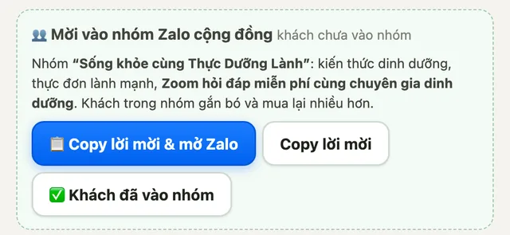
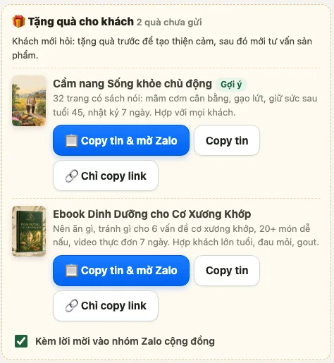
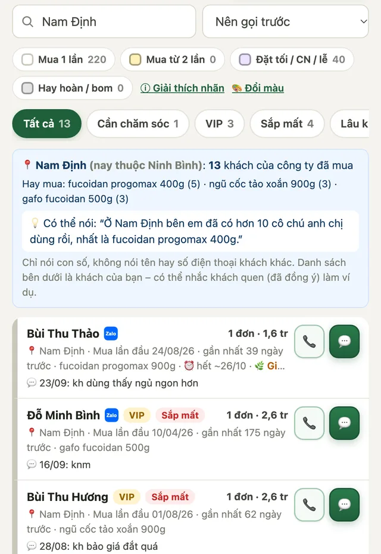
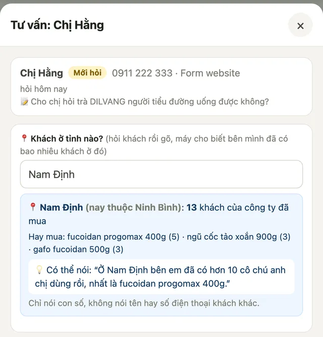

CRM là nơi làm mọi việc với **đơn hàng** và **khách hàng**: xác nhận đơn, gửi tin chăm sóc, theo dõi người hỏi mua, xem doanh số của mình. Dữ liệu vẫn lưu trong Google Sheet của công ty, nhưng bạn không cần mở Sheet.

Mở tại **[crm.thucduonglanh.vn](https://crm.thucduonglanh.vn)**, trên điện thoại hoặc máy tính đều được.

## Đăng nhập

1. Mở [crm.thucduonglanh.vn](https://crm.thucduonglanh.vn), nhập **email đã đăng ký với công ty**, bấm **Gửi mã đăng nhập**.
2. Mở hộp thư, tìm email **“… là mã đăng nhập CRM Thực Dưỡng Lành”**. Không thấy thì xem mục **Spam** hoặc **Quảng cáo**.
3. Nhập **mã 6 số**. Máy tự đăng nhập khi gõ đủ 6 số.

Mã dùng được trong **10 phút**. Đăng nhập xong, máy nhớ bạn trong **30 ngày**. Hết hạn thì làm lại từ bước 1.

> **Báo “Email này chưa được cấp quyền”?** Nhờ anh Sơn hoặc quản lý thêm email của bạn (mục Cài đặt → Nhân sự). Xin mã quá 5 lần thì phải đợi 15 phút.

**Đưa CRM ra màn hình chính điện thoại** (mở nhanh như một ứng dụng):

- **iPhone** (Safari): bấm nút **Chia sẻ** (ô vuông có mũi tên lên) → **Thêm vào MH chính**.
- **Android** (Chrome): bấm **⋮** góc trên → **Thêm vào màn hình chính** (hoặc **Cài đặt ứng dụng**).

## Các tab trong CRM

| Tab | Dùng để |
| --- | --- |
| **Tổng quan** | Chỉ Quản trị thấy. Bức tranh kinh doanh và website trên 1 màn hình (xem mục *Tổng quan* bên dưới). |
| **Hôm nay** | Danh sách việc cần làm trong ngày. Mở tab này đầu tiên mỗi sáng. |
| **Khách đã mua** | Người đã mua ít nhất 1 đơn: chăm sóc sau bán, mời mua lại. Tìm khách, xem lịch sử mua và chăm sóc. |
| **Đơn hàng** | Xác nhận, giao hàng, nhận tiền, sửa đơn, tạo đơn cho khách đặt qua Zalo hoặc điện thoại. |
| **Khách hỏi** | Các **lượt khách để lại số hỏi** (người đang tư vấn chưa mua, kèm lịch sử Đã chốt / Không mua để tính tỷ lệ chốt) (số quảng cáo, trang nhận ebook, form web, nhắn Zalo hỏi giá): tư vấn để chốt đơn đầu tiên. Chốt đơn xong, khách tự sang tab Khách đã mua. |
| **Hiệu quả** | Doanh số, mục tiêu tháng, kết quả chăm sóc của bạn. |
| **Marketing** | Chỉ tài khoản quyền **Marketing** (và Quản trị, vào từ Tổng quan) thấy. Chi phí và hiệu quả quảng cáo từng kênh, data quảng cáo, chiến dịch (xem mục *Marketing* bên dưới). |
| **Sàn** | Chỉ người phụ trách sàn thấy (Quản trị vào từ Tổng quan). Doanh số Shopee, TikTok Shop và tải file đơn hàng từ sàn (xem mục *Sàn TMĐT* bên dưới). |
| **Cài đặt** | Chia theo nhóm: *Của tôi* (tài khoản, Telegram, số khách mỗi ngày, màu thẻ, hướng dẫn nhanh) · *Nhân sự* · *Chia khách* · *Bán hàng & chăm sóc* (nhóm khách, chu kỳ dùng, mẫu tin, hoa hồng, ca tối) · *Kết nối & báo cáo*. Mỗi mục thu gọn 1 dòng ghi đang cài thế nào, có ⚠️ là nên làm; bấm vào để mở ra sửa. Lần đầu vào, **Hướng dẫn nhanh** mở sẵn (cả **Telegram** nếu chưa kết nối); đóng lại thì lần sau CRM nhớ. Nhân viên chỉ thấy nhóm *Của tôi*. Trên điện thoại, Cài đặt là nút **⚙** ở thanh trên cùng. |

- Trên điện thoại các tab nằm ở thanh dưới cùng; tab Khách đã mua ghi gọn là **Khách**.
- **Tab mở sẵn khi vào CRM:** nhân viên vào thẳng **Hôm nay**, quản lý vào **Hiệu quả**, quản trị vào **Tổng quan**. Bấm logo **CRM** góc trái để quay về tab này.
- Chấm đỏ trên tab là số việc đang chờ.
- Nút **⟳** góc trên bên phải: tải lại dữ liệu mới nhất, ví dụ khi đồng nghiệp vừa cập nhật.
- Nút **🔍** góc trên: **tìm nhanh** trên mọi tab. Gõ số điện thoại (từ 3 số), tên khách hoặc mã đơn → hiện khách đã mua, đơn hàng, khách hỏi; bấm là mở. Chỉ tìm được khách bạn được xem.
- Thứ tự tab (từ 16/10/2026): **Hôm nay · Khách hỏi · Khách đã mua · Đơn hàng · Hiệu quả**. Khách hỏi lên thứ 2 vì khách mới cần gọi sớm nhất.
- **Dùng bàn phím (máy tính):** phím **Tab** đi qua các thẻ khách, đơn, khách hỏi; **Enter** để mở.
- **✨ AI** (chỉ hiện khi công ty đã bật): trong hồ sơ khách và cửa sổ Chăm sóc có nút **✨ Tóm tắt khách bằng AI** (3–4 dòng: khách mua gì, lần trước nói gì, lần này nên nói gì); trong *Tin nhắn sẽ gửi* có **✨ Nhờ AI viết tin**. AI không nhận tên và số điện thoại khách. Đây chỉ là gợi ý: **đọc lại và sửa trước khi gửi**, không gửi câu nào hứa chữa bệnh. Mỗi ngày cả công ty dùng tối đa 300 lượt.
- **Chữ đang gõ không mất:** ô *Khách nói gì* (Chăm sóc), *Ghi chú lần này* (Tư vấn khách hỏi) và *✏️ Ghi nhanh* được giữ trên máy 2 ngày. Lỡ đóng cửa sổ thì mở lại khách đó, chữ vẫn còn.
- **Bạn chỉ thấy khách mình phụ trách.** Quản lý thấy toàn bộ. Khi gõ số điện thoại của khách đang do người khác phụ trách, CRM chỉ báo tên người đó và không cho thao tác. Muốn đổi người phụ trách thì nhờ quản lý chuyển.
- Danh sách việc ở tab Hôm nay **chỉ có khách của bạn**. Khách *chưa ai phụ trách* nằm ở mục **🧺 Kho chung**, mục này chỉ quản lý và quản trị thấy, để quản lý chủ động giao khách cho từng người. Bạn xác nhận đơn hoặc chăm sóc khách chưa ai phụ trách trước thì khách đó thuộc về bạn.

### Nhận thông báo Telegram riêng

Vào **Cài đặt → 📲 Thông báo Telegram riêng** → bấm **Kết nối Telegram** → **① Mở Telegram** → trong Telegram bấm **Start / Bắt đầu** → quay lại CRM bấm **② Tôi đã bấm Start**. Bot gửi tin xác nhận là xong.

Từ đó bạn nhận riêng: **đơn mới của khách mình phụ trách**, **khách hỏi mới được giao**, và **danh sách việc lúc 8h sáng**. Nhóm Telegram chung chỉ dành cho quản lý.

### 📋 Bấm để copy

Thông tin có **gạch chân chấm và dấu ⧉** thì bấm vào là copy luôn, rồi dán sang Zalo, trang vận chuyển hay tin nhắn. Copy được tên khách, số điện thoại (copy liền số, ví dụ 0912345678), địa chỉ đầy đủ, mã đơn, email, danh sách sản phẩm và tổng tiền (copy số, ví dụ 310000). Copy xong CRM hiện dòng **“📋 Đã copy: …”** ở cuối màn hình.

Trên danh sách đơn và khách hỏi, bấm vào mã đơn hoặc số điện thoại chỉ copy, không mở thẻ. Bấm chỗ khác trên thẻ thì vẫn mở như cũ.

## Tab Hôm nay

- **Từ 16/10/2026 (đợt 2 cải tiến):** sale mở Hôm nay là thấy ngay **khách cần gọi**. Đầu trang chỉ còn số khách cần chăm sóc, thanh tiến độ, nút **▶ Bắt đầu gọi lần lượt** và **1 dòng mục tiêu** (*🎯 Tháng: đã bán / mục tiêu (%) · Hôm nay: đã bán / cần*). **🎯 Mục tiêu tháng** chi tiết, **🏁 Bảng thi đua** và nút **📋 Báo cáo cuối ngày** nằm ở **cuối trang**. Quản lý vẫn thấy bảng thi đua và các ô số ở đầu trang.
- **🎯 Mục tiêu tháng** (nhân viên): ở cuối trang (mục *🏁 Mục tiêu & thi đua*). Có doanh số đến nay / mục tiêu, thanh tiến độ (vạch đen = hôm nay), trạng thái *Đúng tiến độ / Hơi chậm / Đang chậm*, số còn thiếu và mỗi ngày cần bán bao nhiêu. Dòng **📅 Hôm nay** cho biết hôm nay đã bán được bao nhiêu so với mức cần bán trong ngày. Chưa đặt mục tiêu thì bấm **🎯 Đặt mục tiêu** ngay tại đây.
- **🏁 Bảng thi đua**: ngay dưới mục tiêu tháng (cuối trang với sale). Bấm **Tuần này** / **Tháng này** để đổi kỳ (tuần tính từ thứ Hai, mỗi tuần bắt đầu lại từ 0). Thanh **🤝 Mục tiêu chung cả nhóm** nằm trên cùng, cho biết cả nhóm đạt bao nhiêu % tổng mục tiêu tháng và mỗi ngày cả nhóm cần bán thêm bao nhiêu. Có 4 hạng mục: **🏆 Doanh số** (từ 17/10/2026 xếp theo **% mục tiêu đạt**, không theo số tiền; tuần này so với mục tiêu tháng chia theo ngày. Ai chưa đặt mục tiêu tháng thì chưa vào hạng mục này. **Số tiền chỉ bạn và quản lý thấy**, người khác chỉ thấy %), **🎯 Tỷ lệ chốt** (khách hỏi được giao đã ra đơn, cần ít nhất 3 khách hỏi trong tuần hoặc 5 trong tháng), **💚 Khách cũ quay lại** (số khách cũ mua thêm), **🚀 Tiến bộ nhất** (doanh số so với cùng kỳ tuần / tháng trước, cần kỳ trước từ 500k). Ai cũng thấy **Top 3** của từng hạng mục. Dòng dưới cùng là **hạng của bạn** và còn cách người ngay trên bao nhiêu. Hạng của mỗi người chỉ người đó thấy. Quản lý thấy đủ bảng ở đầu tab Hôm nay, kể cả khi đang lọc 1 nhân viên. Số liệu cập nhật khoảng 10 phút một lần. Nếu bảng báo *Chưa tải được* thì bấm **🔄 Thử lại** sau ít phút.
- **Trên cùng:** số khách cần chăm sóc hôm nay, thanh tiến độ và nút **▶ Bắt đầu gọi lần lượt**. Mỗi ngày CRM đưa ra tối đa **30 khách** (đổi ở **Cài đặt → Số khách chăm sóc mỗi ngày**), khách quan trọng trước: hẹn gọi lại → hỏi nhận hàng → sắp hết hàng → việc bị trễ → các việc khác. Khách chưa tới lượt tự dời sang hôm sau.
- **Ô nhỏ** (quản lý): đơn mới, khách hỏi, việc đã làm, mục tiêu tháng. Bấm để mở đúng danh sách. Quản lý thấy thêm doanh số và khách mới của tháng.
- **Gọn gàng khi mới mở:** chỉ **mục cần gọi đầu tiên** được mở sẵn (thường là *Đơn mới*, nếu không có thì *Khách vừa hỏi* hoặc nhóm chăm sóc đầu tiên) và chỉ hiện **5 khách đầu**. Bấm **Xem thêm … khách** để hiện tiếp. Các mục khác đều gập lại, bấm vào tên mục khi tới lượt gọi. CRM nhớ mục nào bạn đã mở hay gập trong lúc dùng.
- **1️⃣ Đơn mới – gọi khách xác nhận** (chỉ hiện khi có), kèm **Chuyển khoản chưa nhận tiền**.
  - **Ai thấy đơn mới:** Quản lý / Quản trị thấy tất cả. Nhân viên sale **chỉ thấy đơn đã giao cho mình**: đơn quản lý giao, hoặc đơn của khách mình đang phụ trách đặt lại. Đơn chưa giao thì không hiện với nhân viên nào, ở cả **Hôm nay** lẫn tab **Đơn hàng**.
  - **Quản lý giao đơn:** trên mỗi đơn mới có ô **Giao cho…**, chọn tên nhân sự là xong. Người đó sẽ thấy đơn ở **Hôm nay**. Chọn **Bỏ giao** để rút lại. (Người được giao cũng là *NV bán* của đơn, tính vào doanh số.)
- **2️⃣ 🔥 Khách vừa hỏi – liên hệ ngay** (chỉ hiện khi có): người hỏi trong 24 giờ qua mà chưa ai liên hệ. Đây là khách nóng nhất, gọi càng sớm càng dễ chốt.
- **3️⃣ Chăm sóc khách:** chia nhóm theo loại việc (xem [bảng các loại việc](#cac-loai-viec-cham-soc)). Nhóm đầu tiên tự mở sẵn (nếu phía trên chưa có mục nào mở), các nhóm khác bấm vào mới mở. Mỗi khách 1 dòng với nút **📞 Gọi · 📵 KNM · 💬 Chăm sóc**. Dưới tên khách có dòng **🕘 lần liên hệ gần nhất** (vd *“3 ngày trước: Đã hỏi thăm: chị bảo ngủ ngon hơn”*, kèm *📵 2 lần KNM liền* nếu gọi mãi không được) để biết lần trước đã nói gì trước khi gọi. Khách chưa ai liên hệ thì ghi *🆕 Chưa liên hệ lần nào*.
    - **⚠️ Khách VIP trễ hạn**: khách VIP quá hạn chăm sóc từ 2 ngày được gom thành nhóm riêng ngay sau *Hẹn gọi lại*, dòng khách ghi rõ việc cần làm. Khi bấm *Bắt đầu gọi lần lượt*, các khách này cũng được gọi trước.
    - **🎂 Sinh nhật**: khách có sinh nhật trong 7 ngày tới có nhãn hồng (*Sinh nhật hôm nay*, *SN ngày mai*, *SN 12/10*). Nhớ nhắn chúc mừng. Cần nhập ngày sinh trong hồ sơ khách thì nhãn mới hiện.
    - **💡 Gợi ý sản phẩm**: ở các việc *Sắp hết*, *Giới thiệu sản phẩm phù hợp*, *Mời quay lại*, *Khách cũ lâu chưa gọi*, CRM gợi ý sản phẩm mà những khách mua giống khách này hay mua thêm. Đây chỉ là gợi ý, sale tự xem có hợp với khách không.
    - Việc *Sắp hết sản phẩm* ghi luôn ngày dự kiến hết, ví dụ *Còn khoảng 5 ngày là hết (11/10)*.
- **4️⃣ Khách hỏi cần liên hệ:** đến ngày hẹn, đã 3 ngày chưa liên hệ lại, hoặc hỏi đã lâu mà chưa ai liên hệ.
- **Khách cũ hỏi lại** (thẻ có nhãn 🔁): khách đã từng mua nay để lại số qua quảng cáo / web. Mỗi khách chỉ có **1 thẻ**. Thẻ hiện tên, nhãn VIP và số đơn đã mua; bấm vào dòng *👤 … đơn* để mở hồ sơ khách. Khách này không hiện lặp lại ở mục *Chăm sóc khách*. Ở tab **Khách đã mua**, khách này có nhãn *🔁 Đang hỏi lại*.
- Số đỏ trên tab **Hôm nay** = đơn mới + khách cần chăm sóc + khách vừa hỏi. Tất cả khách hỏi cần liên hệ xem ở số đỏ của tab **Khách hỏi**.
- Cuối trang: **✅ Đã làm hôm nay** (bấm để mở).

### Gọi lần lượt

Bấm **▶ Bắt đầu gọi lần lượt**: CRM mở **từng khách một** (tên, tổng chi / số đơn, sản phẩm hay mua và chu kỳ mua lại, ngày dự kiến hết hàng, lần cuối khách trả lời, ghi chú sức khoẻ, **lịch sử mua** từng đơn (bấm *Xem thêm* để xem đơn cũ), 3–4 lần chăm sóc gần nhất, tin nhắn mẫu). Gọi hoặc nhắn xong, bấm **1 nút kết quả**, CRM **tự sang khách tiếp theo** (“Khách 3 / 24”). **⏭ Để sau** bỏ qua khách đó trong lượt này; **✕** để dừng.

## Xử lý đơn hàng

Tab **Đơn hàng** mở sẵn mục **⚡ Cần xử lý**, chỉ gồm những đơn cần làm, chia nhóm:

| Nhóm | Đơn nào | Việc cần làm |
| --- | --- | --- |
| 🆕 **Chờ xác nhận** | Đơn mới (nhân viên chỉ thấy đơn đã giao cho mình; quản lý giao bằng ô **Giao cho…**) | Gọi khách, bấm **✅ Xác nhận** |
| 📦 **Chờ gửi hàng** | Đã xác nhận, chưa có mã vận đơn | Đóng hàng, bấm **📦 Nhập mã VĐ** |
| 📵 **Giao chưa được** | Viettel Post báo khách vắng nhà, hẹn ra bưu cục, sắp hoàn | Gọi khách ngay, hẹn lại giờ giao để giữ đơn |
| 🚚 **Giao lâu chưa tới** | Đã gửi quá 5 ngày mà vẫn Đang giao | Gọi hỏi khách, giục bưu cục để tránh hoàn |
| 💳 **Chưa nhận tiền** | Chuyển khoản chưa thấy tiền về | Kiểm tra tài khoản, mở đơn bấm “đã nhận tiền” |
| ↩ **Hoàn gần đây** | Đơn hoàn (đặt trong 3 tuần) | Gọi hỏi lý do, giữ khách |

Mỗi đơn 1 dòng: **📍 tỉnh giao đến**, ngày đặt, thanh toán, sản phẩm, mã vận đơn, **🚚 số ngày đang giao** (màu cam ⚠️ khi quá 5 ngày), 1 nút đúng việc tiếp theo và nút 📞.

Trên mỗi dòng đơn còn có:
- **⚠️ đã hoàn N lần** (nhãn đỏ): khách này từng hoàn đơn. Gọi xác nhận kỹ trước khi gửi, đơn lớn nên nhờ khách chuyển khoản trước.
- **📌 Ghi chú giao hàng** (khung vàng): ghi chú có giờ giao, gọi trước, cho xem hàng… được hiện nổi bật để không bị sót.
- **Mã vận đơn** bấm được: CRM copy sẵn mã và mở trang tra cứu của hãng vận chuyển (Viettel Post, BEST Express, GHN, GHTK, J&T… mở trang tra cứu đã điền sẵn mã; Viettel Post và BEST chỉ cần tích/kéo ô xác minh "không phải người máy" là xem được hành trình; VNPost thì dán mã vào ô tra cứu).
- **📦 Hành trình Viettel Post** (dòng chữ xanh): đơn Viettel Post tự cập nhật vị trí mới nhất, ví dụ "06/10 09:00 · Giao bưu tá đi phát · Bưu cục Thái Nguyên". Khi Viettel Post báo giao không được (khách vắng, hẹn, chuyển hoàn), dòng này chuyển **khung đỏ ⚠️**, đơn vào nhóm **📵 Giao chưa được** và Telegram báo nhóm + bạn (người bán).
- **Đơn vị vận chuyển của đơn nhập từ file sale** CRM tự điền theo cột MÃ ĐƠN: mã bắt đầu bằng **V** (VPhuong060902) → **Viettel Post**; ghi **xe ôm** → **Xe ôm**; ghi tự giao / tại kho → **Tự giao**; mã sale thường (Phuong240904) → **BEST Express**. Lưu ý: **mã đơn của sale không phải mã vận đơn**, nên không tra cứu được trên trang của hãng. Mã vận đơn thật là mã in trên phiếu gửi. Khi tạo đơn trên Viettel Post, nếu ghi mã đơn (VPhuong…) vào ô *mã đơn hàng riêng / tham chiếu* thì CRM tự điền mã vận đơn thật khi Viettel Post báo trạng thái.
- Đơn Viettel Post **tự đổi trạng thái**: giao thành công → **Đã giao**, đã trả về shop → **Hoàn**. Không cần bấm tay; nhật ký ghi người làm là "Viettel Post (tự động)". Đơn hãng khác (BEST…) vẫn bấm tay như cũ.
- Đơn COD đang giao ghi **thu hộ** trước số tiền. Ô **🚚 Đang giao** phía trên cho biết tổng tiền thu hộ bưu cục đang giữ.

**Số ngày đang giao** tính từ **ngày gửi hàng**: CRM tự ghi ngày gửi khi bạn bấm **Đang giao** hoặc nhập mã vận đơn. Đơn cũ chưa có ngày gửi (vd đơn nhập từ file) thì tính từ ngày đặt; rê chuột vào ô số ngày để xem tính từ ngày nào. Khách đã nhận hàng thì nhớ bấm **📬 Đã giao** để đơn không còn bị báo giao lâu.

Bấm vào dòng để mở đơn (Zalo, sửa đơn, ghi chú…). Thẻ **📋 Tất cả đơn** để tra cứu: bấm 1 chạm ở hàng nút thời gian (*Hôm nay · Hôm qua · Tuần này · Tháng này · Tháng trước · Quý này · Năm nay · Mọi lúc*) hoặc **📅 Khác**, rồi lọc theo **kênh** (🌐 *Khách tự đặt trên web* hoặc 💬 *Sale lên đơn*) và theo trạng thái. Đơn khách tự đặt trên thucduonglanh.vn có nhãn **🌐 Web · Facebook / Google / Zalo / Vào thẳng web…** (khách vào web từ đâu). Đầu trang có số đơn và doanh số hôm nay, số đơn đang giao, tỷ lệ hoàn tháng này.

Đơn khách đặt trên web tự vào CRM và báo lên Telegram. Mỗi đơn đi qua các trạng thái:

**Mới → Đã xác nhận → Đang giao → Đã giao** (hoặc **Huỷ**)

1. **Gọi khách xác nhận.** Bấm **📞 Gọi** hoặc **Zalo** ngay trên thẻ đơn. Đơn có ghi chú **“Kiểm tra địa chỉ”** thì hỏi lại khách phường, xã cho chính xác. Xong bấm **✅ Xác nhận**.
2. **Đơn chuyển khoản.** Mở tài khoản VCB, thấy tiền về **đúng số tiền**, nội dung có **mã đơn** (ví dụ TDL2609271234), thì mới mở đơn bấm **💳 Xác nhận đã nhận tiền**. Chưa thấy tiền thì đơn nằm ở mục *Chuyển khoản chưa nhận tiền* để nhắc.
3. **Gửi hàng.** Mở đơn, mục **Vận chuyển**: nhập **mã vận đơn** (mã bắt đầu bằng **V** thì CRM tự chọn **Viettel Post**, mã toàn số thì tự chọn **BEST Express**; hãng khác thì chọn tay), bấm **Lưu vận đơn**. Đơn tự chuyển sang **Đang giao**. Nút **🔎 Tra cứu hành trình** mở trang của hãng vận chuyển (mã đã được copy sẵn).
4. **Khách nhận hàng**: bấm **📬 Đã giao**.
5. **Huỷ đơn**: mở đơn, chọn **Huỷ**, ghi lý do. Đơn huỷ không tính vào doanh số.

Các nút khác khi mở đơn:

- **📋 Copy thông tin giao hàng**: copy tên, số điện thoại, địa chỉ, sản phẩm, tổng tiền để dán vào app vận chuyển.
- **✏️ Sửa đơn**: đổi sản phẩm, số lượng, địa chỉ, phí ship. Số đơn, tổng chi của khách tự tính lại.
- **Ghi chú đơn**: ghi những điều cần nhớ, ví dụ “giao giờ hành chính”.
- **Nhân viên bán** (quản lý mới sửa được): người được tính doanh số của đơn.

> **Tổng tiền** đã gồm phí ship: đơn dưới 300.000đ cộng 30.000đ, từ 300.000đ được miễn phí.
>
> **Bấm nhầm trạng thái?** Mở đơn, chọn lại trạng thái đúng. Mọi thay đổi đều được ghi lịch sử.

## Lên đơn (giống sheet VTG_lendon)

Vào **Đơn hàng → ＋ Tạo đơn**, hoặc bấm **＋ Đơn** trong hồ sơ khách.

1. **Khách hàng**: bấm **📋 Dán tin nhắn của khách** rồi dán nguyên tin Zalo (tên, số điện thoại, địa chỉ). CRM tự tách vào các ô, bạn chỉ cần kiểm tra lại. Hoặc gõ **số điện thoại**: khách cũ thì tên và địa chỉ tự điền. Khách có nhãn ⚠️ *Bom hàng* thì CRM cảnh báo. Số của người đang ở tab **Khách hỏi** (chưa mua) thì CRM điền tên, tỉnh (nếu lúc tư vấn có ghi 📍) và đưa sản phẩm khách quan tâm lên đầu; lưu đơn xong khách tự chuyển sang **Đã chốt**. Địa chỉ nhận sai tỉnh / phường thì bấm *Sửa tỉnh / phường*.
2. **Khách cũ mua lại**: bấm **🔁 Đặt lại như đơn trước**. Sản phẩm, quà, số tiền tự điền giống đơn gần nhất, sửa chỗ nào khác là xong.
3. **Sản phẩm**: bấm nút tên sản phẩm (sản phẩm khách hay mua và sản phẩm bán chạy hiện trước). Bấm thêm lần nữa để tăng số lượng. Sản phẩm khác thì bấm **＋ Sản phẩm khác** và gõ tên. Có quà thì bấm **🎁 Thêm quà**.
4. **Loại đơn (tính hoa hồng)** (hoa hồng tính trên **tiền hàng**, không gồm phí ship, không tính đơn huỷ / hoàn; đơn nhập từ file Sheet chỉ có 1 ô Số tiền nên tính cả số đó): chọn 1 trong 4 – 🆕 **Khách mới**, 🔁 **Khách cũ**, 🌙 **Ngoài giờ** (tối sau giờ ca tối hoặc Chủ nhật), 🎉 **Ngày lễ**. CRM chọn sẵn theo gợi ý, ưu tiên Lễ → Ngoài giờ → Mới/Cũ, lý do ghi ngay bên dưới (💡 CRM gợi ý…). Khách đã từng mua nhưng **vừa để lại số qua quảng cáo** (trong 30 ngày) vẫn là **Khách mới**. Bạn chọn khác gợi ý thì khung chuyển màu cam: vẫn lưu được, nhưng đơn sẽ được **quản lý kiểm tra lại**.
5. **Số tiền thu khách**: gõ `1800000`, `1tr8` hoặc `1,8tr` đều được. Giá linh động, CRM chỉ nhắc giá niêm yết để tham khảo. Chọn **COD** hoặc **Chuyển khoản**, ghi **ghi chú giao hàng** nếu có.
6. Dòng **⚙️ Tuỳ chọn khác** gồm các mục ít đổi (khách đặt qua, trạng thái, phí ship riêng, đồng ý nhận ưu đãi). Cần sửa thì bấm vào. *Khách đặt qua* nhớ lựa chọn lần trước của bạn. **Chọn đúng *Khách đặt qua*** (khách đến từ Facebook, Zalo, TikTok, người quen giới thiệu…): đây là **nguồn khách** CRM ghi lại cho khách mua lần đầu, hiện ở đầu hồ sơ khách và trên thẻ khách ở tab Hôm nay, Khách đã mua (🌐 Website, 📘 Facebook Ads…). Số từ file quảng cáo trong tab Khách hỏi ghi kênh 📘 Facebook Ads, tên chiến dịch nằm ở “Quan tâm”.
7. Bấm **Lưu & copy lên đơn**: đơn được lưu, nội dung lên đơn đã copy sẵn, dán sang bên vận chuyển. **Mã đơn** tự tạo theo kiểu cũ, ví dụ *Phuong300926-01*.
   - Nếu khách đã có đơn **cùng số tiền trong 1 giờ qua**, CRM hỏi lại trước khi lưu (tránh trùng khi lần trước mạng chập chờn nhưng đơn đã lưu). Bấm **Huỷ** để xem lại tab Đơn hàng; chỉ bấm **OK** khi khách thật sự đặt thêm đơn.

**Quản lý kiểm tra loại đơn:** đơn sale chọn khác gợi ý có nhãn **⚠️ Kiểm tra loại đơn** và nằm trong **Đơn hàng → Cần xử lý → Kiểm tra loại đơn**. Mở đơn, bấm **✓ Đúng** (giữ lựa chọn của sale) hoặc **Đổi sang** loại khác. % hoa hồng từng loại đặt ở **Cài đặt → 💰 Hoa hồng**; báo cáo **BCDT** có mục *Theo loại đơn* với doanh số và hoa hồng tạm tính của từng sale.

**Đơn khách tự đặt trên web** (🌐) tính hoa hồng **riêng**, theo ô *🌐 Đơn khách tự đặt trên web (%)* ở **Cài đặt → 💰 Hoa hồng**, không theo 4 loại đơn. Hoa hồng đơn web tính cho sale đang phụ trách khách lúc khách đặt. Để trống = chưa tính.

Khách đặt qua Zalo, Facebook, điện thoại hay mua tại cửa hàng thì **luôn tạo đơn trên CRM**: khách sẽ được nhắc chăm sóc và tính doanh số cho bạn như đơn web.

Khách **đã tự đặt trên website** mà bạn lên lại đơn trong file sale (mã đơn của bạn: tên + ngày + số thứ tự) thì CRM **không tạo thêm đơn**: đơn web tự đổi sang mã bạn gõ, trạng thái theo file, vẫn ghi là đơn 🌐 Web (mã web cũ TDL… vẫn tìm được). Điều kiện: cùng số điện thoại, cùng số tiền, lên trong vòng 10 ngày sau khi khách đặt web.

**Ngày của đơn trong file** (từ 16/10/2026): CRM tính doanh số theo **cột ngày** (ngày chốt), không theo ngày trong mã đơn. Mã đơn vẫn ghi ngày gửi hàng cho bộ phận đóng đơn như bình thường. Ô ngày để trống thì CRM lấy ngày của dòng gần nhất phía trên, nên hãy ghi ngày ở dòng đầu mỗi ngày. Ô ngày lệch mã đơn quá 7 ngày (thường do gõ nhầm tháng) thì CRM chọn ngày khớp với các dòng xung quanh.

**Sửa số điện thoại của đơn đã lên trong file**: CRM **không tạo thêm đơn**, giữ đơn cũ (số cũ) và báo Quản trị qua Telegram + Nhật ký. Điều kiện: cùng mã đơn, cùng số tiền, cách nhau không quá 7 ngày, và cùng tên khách hoặc số chỉ khác 1–2 chữ số. Số mới đúng thì Quản trị mở đơn trên CRM sửa số điện thoại; số mới sai thì bạn sửa lại file. Đổi số trên đơn đã có thì tốt nhất báo quản lý sửa luôn trên CRM.

Trong hồ sơ khách, ô **Ghi nhanh hôm nay** tự thêm ngày ở đầu dòng, giống cách ghi trên Sheet: *“30/09: kh dùng ok, hẹn cuối tháng lấy tiếp”*. Nhật ký chăm sóc cũ từ file của bạn nằm ngay bên dưới.

### Chăm sóc, tỉnh thành và lý do từ chối (tab Hiệu quả → Xem chi tiết)

- **💬 Chăm sóc khách:** lượt chăm sóc và **% kết nối** (khách nghe máy / trả lời), **chăm sóc ra đơn** (khách được chăm sóc đã mua trong 14 ngày sau đó), **khách quay lại mua**, **tỷ lệ hoàn đơn**, **VIP sắp mất chưa gọi** (bấm để mở danh sách).
- **📍 Khách theo tỉnh / thành:** biểu đồ tỉnh nào nhiều khách / doanh số nhất, gộp theo 34 tỉnh mới (rê chuột để xem tỉnh cũ, vd Hưng Yên gồm cả Thái Bình). Chọn *Khách mới tháng này* để xem khách mới đến từ đâu.
- **🙅 Lý do khách chưa mua / từ chối:** máy tự gom ghi chú khi chăm sóc thành các nhóm (hết tiền, còn hàng, dùng sản phẩm khác, người nhà quyết định, sức khoẻ / đi vắng, chưa thấy hợp, chê giá, bận…) kèm câu khách nói. Chọn *Toàn bộ* để xem cả ghi chú cũ từ file Sheet. Muốn số liệu đúng, khi gọi nhớ gõ vài chữ khách nói vào **Ghi chú lần này**.

### Báo cáo ngày gửi nhóm Zalo

Cuối ngày bấm **📋 Báo cáo cuối ngày (gửi Zalo)** ở tab **Hôm nay** (hoặc **Hiệu quả → 📋 Báo cáo ngày**). CRM tự làm báo cáo đúng mẫu nhóm đang dùng: số đơn và số mới từng dòng (Curcumin, BADD, Fucoidan Pro), sản phẩm khác, đơn từ khách cũ, **tổng doanh số**, đơn ngoài giờ, **🕘 doanh số theo giờ lên đơn** (giờ hành chính 8:00–17:30 thứ 2 – thứ 7 / buổi tối & Chủ nhật / ngày lễ), đơn hoàn, **KH cũ đã chăm sóc (kết nối)**, **Không nghe máy**, **Lý do từ chối** (lấy từ ghi chú khi bấm *Hết tiền*, *Còn hàng*, *Không dùng nữa*…) và **luỹ kế tháng / % mục tiêu**. Sửa thêm nếu cần, bấm **📋 Copy để dán vào Zalo** rồi dán vào nhóm. Bên dưới ô báo cáo có bảng **🕘 Đơn trong ngày theo giờ lên đơn** (giờ, mã đơn, khách, số tiền, ca) để xem chi tiết, phần này không copy sang Zalo. Đơn nhập từ file sale chỉ có ngày nên ghi *Không rõ giờ*. Chọn ngày khác để làm báo cáo bù. Quản lý chọn được *Cả nhóm* hoặc từng người.

Tab **Hiệu quả → 📊 Bảng BCDT** tự làm báo cáo doanh số tháng: theo ngày, theo dòng sản phẩm, khách mới / cũ, đơn hoàn và doanh số theo ca. Phía trên có sẵn **tỷ lệ chốt** (data mới đã ra đơn / data mới, cách tính như tab Hiệu quả; bảng có thêm cột *Data quảng cáo*, *Data ra đơn* theo từng ngày), **trung bình mỗi đơn khách mới** và **khách cũ**, **% doanh số từ khách cũ**, **doanh số ngoài giờ** (theo loại đơn tính hoa hồng), mục **🕘 Theo giờ lên đơn** (giờ hành chính / tối & Chủ nhật / ngày lễ, tính đúng theo giờ bấm Lưu đơn; bảng có cột tương ứng theo từng ngày), **số khách cũ đã chăm sóc / không nghe máy** và **% tiến độ mục tiêu**. Mục **Theo kênh đơn** tách doanh số *💬 Sale lên đơn* và *🌐 Khách tự đặt trên web* (kèm số đơn web theo nguồn: Facebook, Google…). Cột nào cả tháng bằng 0 (dòng sản phẩm không bán) thì tự ẩn cho gọn. Bấm **Tải file Excel** để gửi báo cáo.

## Chăm sóc khách

### Các loại việc chăm sóc

CRM tự tính ngày cần liên hệ từng khách, dựa vào **ngày khách nhận hàng** và thời gian dùng hết sản phẩm. Ngày nhận hàng là ngày đơn chuyển **Đã giao**, hoặc ngày bạn bấm **📦 Đã nhận, đã HD dùng** khi gọi. Chưa biết ngày nhận thì máy ước tính = **ngày gửi hàng** + số ngày giao hàng trung bình (mặc định 3 ngày, quản lý sửa ở Cài đặt → Nhóm khách). Đơn chưa ghi ngày gửi thì tính từ ngày đặt. Đơn còn **chờ xác nhận / chờ gửi** thì CRM chưa nhắc hỏi nhận hàng.

| Việc | Khi nào | Nên làm gì |
| --- | --- | --- |
| 📞 **Hẹn gọi lại** | Đến ngày khách đã hẹn | Gọi lại đúng hẹn |
| 📦 **Hỏi nhận hàng, hướng dẫn dùng** | Ngày khách nhận hàng đến 2 ngày sau. Đơn còn **Mới / Đã xác nhận / Đang giao** thì chờ quá số ngày giao hàng + 2 ngày (mặc định 5 ngày sau ngày đặt) mới nhắc, thẻ khách ghi rõ "đơn vẫn Đang giao" | Hỏi đã nhận hàng chưa, gửi cách dùng. Bấm **📦 Đã nhận, đã HD dùng** hoặc **🚚 Chưa nhận hàng** (2 ngày sau tự nhắc lại) |
| ⏰ **Sắp hết / đã hết sản phẩm** | Gần ngày khách dùng hết | Nhắc đặt lại, gợi ý thêm món để đơn từ 300.000đ được miễn phí ship |
| 🤝 **Hỏi thăm sau 1 tuần** | Chỉ khách **mua lần đầu**: 7 ngày sau khi nhận hàng (đến 3 ngày sau). Đã chăm sóc khách từ ngày thứ 4 sau khi nhận thì thôi | Hỏi khách dùng có khó khăn gì, cần hỗ trợ gì. Mời vào nhóm Zalo cộng đồng nếu khách chưa vào |
| 💬 **Xin cảm nhận** | 14 ngày sau khi nhận hàng | Hỏi cảm nhận, xin phép chia sẻ |
| 🌿 **Giới thiệu sản phẩm phù hợp** | 30 ngày sau khi nhận hàng | Giới thiệu sản phẩm khác hợp với khách |
| 💌 **Mời quay lại** | 60 ngày sau khi nhận hàng, chưa mua lại | Hỏi thăm, gửi ưu đãi khách cũ |
| 🔁 **Khách cũ lâu chưa gọi** | Quá 30 ngày khách chưa phản hồi (không tính các lần không nghe máy) | Hỏi thăm, hỏi còn hàng không, mời đặt lại |

**🕑 Giãn cách chăm sóc:** khách đã **trả lời** bạn (không tính *Không nghe máy*) trong vòng **14 ngày** thì CRM **không nhắc** *Sắp hết hàng*, *Xin cảm nhận*, *Giới thiệu sản phẩm*, *Mời quay lại*, để khách không bị gọi dồn dập. Vẫn nhắc **hẹn gọi lại**, **hỏi nhận hàng** đơn mới và **hỏi thăm sau 1 tuần** (khách mua lần đầu). Khách vừa đặt đơn thì chưa tính là *Khách cũ lâu chưa gọi*. Quản lý đổi số ngày ở **Cài đặt → Nhóm khách** (ghi 0 = tắt).

Việc nào **qua khung mà chưa làm** (ví dụ bạn nghỉ vài hôm) vẫn hiện thêm 7 ngày, kèm dòng **⏳ trễ N ngày**, để không sót khách. Khi đã tới mốc sau (vd đã tới ngày 14) thì mốc trước chưa làm tự bỏ qua, chỉ hiện mốc mới nhất.

**🌟 Khách quen sản phẩm** (mua lại đúng sản phẩm đã dùng, lần mua trước trong 6 tháng, đơn trước không bị hoàn) đã biết cách dùng nên CRM **không nhắc** *Hỏi nhận hàng*, *Hỏi thăm sau 1 tuần*, *Xin cảm nhận*. Vẫn nhắc **Sắp hết hàng**, **Giới thiệu sản phẩm**, **Mời quay lại** và hẹn gọi lại. Đơn có **sản phẩm mới** thì vẫn đủ các mốc. Nhãn **🌟 Khách quen SP** hiện trong hồ sơ khách. Quản lý chỉnh số lần mua để tính là khách quen ở **Cài đặt → Nhóm khách** (mặc định 1 lần, ghi 0 = tắt).

### 👥 Mời khách vào nhóm Zalo cộng đồng

Nhóm **“Sống khỏe cùng Thực Dưỡng Lành”** chia sẻ kiến thức dinh dưỡng, thực đơn lành mạnh và thông báo các buổi **Zoom hỏi đáp miễn phí cùng chuyên gia dinh dưỡng**. Khách trong nhóm gắn bó và mua lại nhiều hơn, nên mời mọi khách đã mua.

- Trong hộp **💬 Chăm sóc** của khách chưa vào nhóm có khung **👥 Mời vào nhóm Zalo cộng đồng**. Ở mốc **Hỏi nhận hàng** và **Hỏi thăm sau 1 tuần** khung này mở sẵn; mốc khác bấm vào để mở.
- Bấm **📋 Copy lời mời & mở Zalo**: CRM điền tên khách + link nhóm, copy sẵn và mở khung chat. Dán, gửi. Khách được ghi là **Đã mời**.
- Khách vào nhóm rồi thì bấm **✅ Khách đã vào nhóm**. Tên khách có thêm biểu tượng 👥 và không bị nhắc mời nữa.
- Mời hàng loạt: tab **Khách đã mua** → lọc **👥 Chưa vào cộng đồng** → **📣 Gửi ưu đãi lần lượt**, dán lời mời làm nội dung.
- Tab **Hiệu quả** có ô **Khách trong nhóm cộng đồng** (% khách đã vào nhóm).
- Quản lý sửa câu mời ở tab **Mẫu tin nhắn CSKH** trong Sheet, dòng **“Mời vào cộng đồng”** (giữ chữ **[Link nhóm]** để CRM tự chèn link).

### 🎁 Tặng quà cho khách (cẩm nang, ebook)

Công ty có 2 món quà miễn phí để **thêm giá trị cho khách**: cẩm nang **“Sống khỏe chủ động”** (32 trang, có sách nói, hợp với mọi khách) và ebook **“Dinh Dưỡng cho Cơ Xương Khớp”** (kèm video thực đơn 7 ngày, hợp khách lớn tuổi, đau mỏi, gout). Mở lời bằng một món quà dễ được khách trả lời hơn là chào bán.

- Khung **🎁 Tặng quà cho khách** có ở: hộp **💬 Chăm sóc**, hồ sơ khách, hộp **Tư vấn** và trang chi tiết **khách hỏi**. Ở mốc **Hỏi nhận hàng**, **Hỏi thăm sau 1 tuần** và khi tư vấn khách mới hỏi, khung mở sẵn.
- Quà có nhãn **Gợi ý** là quà hợp nhất với khách: CRM xem sản phẩm khách mua, điều khách quan tâm, ghi chú. Khách có nhắc tới khớp, xương, gout… thì gợi ý ebook, còn lại gợi ý cẩm nang.
- Bấm **📋 Copy tin & mở Zalo**: CRM điền tên khách và link quà, copy sẵn, mở khung chat. Dán, gửi. Lời mời vào nhóm Zalo cộng đồng được kèm sẵn nếu khách chưa vào nhóm (bỏ tích nếu không muốn).
- **🔗 Chỉ copy link** khi bạn muốn tự viết lời nhắn.
- Gửi xong, quà hiện **✓ Đã gửi ngày… (tên người gửi)**, ghi vào Nhật ký là **“Gửi quà tặng”**. Khách đã tự nhận quà trên web thì hiện **✓ Khách đã tự nhận trên web**, không cần gửi lại.
- Link gửi từ CRM mở thẳng sách, khách **không phải điền form** (khách đã có trong CRM rồi).
- Gợi ý thời điểm: khách vừa nhận hàng; khách mới hỏi (tặng trước, tư vấn sau); khách lâu chưa liên lạc; khách hỏi về chế độ ăn.
- Quản lý muốn sửa lời nhắn: **Cài đặt → Mẫu tin nhắn**, thêm dòng Thời điểm **“Quà tặng”**, Mục đích có chữ **“cẩm nang”** hoặc **“ebook”**, nội dung dùng **[Tên]** và **[Link quà]**.

### Cách chăm sóc 1 khách

1. Bấm nút **💬** trên dòng khách (hoặc **▶ Bắt đầu gọi lần lượt** ở tab Hôm nay).
2. **Bước 1 – Gọi hoặc nhắn:** có 2 nút lớn **📞 Gọi** và **💬 Nhắn Zalo**. Bấm **Nhắn Zalo** thì CRM copy sẵn tin nhắn (đã chọn mẫu hợp với việc, điền tên khách và sản phẩm) và mở Zalo, bạn chỉ cần dán và gửi. Muốn xem hoặc sửa tin trước khi gửi thì bấm **✏️ Tin nhắn sẽ gửi** (khách đã kết bạn Zalo thì khung này mở sẵn).
3. Quay lại CRM. **Bước 2 – Khách thế nào?** Khách có nói gì thì gõ vài chữ vào ô **Khách nói gì** trước (không bắt buộc), rồi **bấm 1 nút**. Bấm xong là lưu luôn và máy tự hẹn ngày gọi lại:

    | Nút | Máy ghi | Tự nhắc gọi lại |
    | --- | --- | --- |
    | 📵 **KNM** | knm (không nghe máy) | sau 2 ngày |
    | 📴 **Thuê bao** | thuê bao | sau 3 ngày |
    | 🙅 **Từ chối nghe** | từ chối nghe | sau 7 ngày |
    | 👍 **Dùng ok** | kh dùng ok | không hẹn |
    | 📦 **Còn hàng** | kh còn nhiều | sau 14 ngày |
    | 💸 **Hết tiền** | kh hết tiền, hẹn tháng sau | sau 30 ngày |
    | 🛒 **Đặt lại** | kh đặt lại, rồi mở luôn form tạo đơn | không hẹn |
    | 🚫 **Không dùng nữa** | kh không dùng nữa | không hẹn |

    Chữ gõ ở ô **Khách nói gì** được ghi kèm. Ở tab Hôm nay, thẻ khách có sẵn nút **📵 KNM**: gọi không được thì bấm ngay, không cần mở hộp chăm sóc.

    **📅 Khách hẹn gọi lại** (từ 16/10/2026): khách bảo *gọi lại sau* thì bấm 1 nút **Mai · 3 ngày · 1 tuần · 2 tuần** là lưu luôn kết quả *Hẹn gọi lại* kèm ngày, ghi chú đang gõ cũng được lưu.

    Không có nút phù hợp, hoặc muốn hẹn đúng 1 ngày cụ thể khác: bấm **Kết quả khác / tự chọn ngày hẹn**, chọn 1 kết quả rồi bấm **Lưu kết quả**:
    - **Đã đặt lại**: khách đặt thêm. Nhớ tạo đơn nếu khách đặt qua Zalo.
    - **Hẹn gọi lại**: chọn ngày hẹn (máy gợi ý 2 ngày sau). Đến ngày, khách tự hiện lại ở tab Hôm nay.
    - **Không nghe máy**: gọi hoặc nhắn mà khách chưa trả lời.
    - **Đã hỏi thăm**: đã nói chuyện, khách chưa cần mua.
    - **Không có nhu cầu**: khách không muốn mua thêm.
4. Lưu xong, khách rời khỏi danh sách hôm nay. Chưa gọi được mà muốn để lát nữa thì bấm **Để sau**.

Khung **👥 Mời vào nhóm Zalo** và **🎁 Tặng quà** trong hộp chăm sóc được thu gọn thành 1 dòng; bấm vào dòng đó để mở. Nhớ gửi quà / lời mời **trước** khi bấm nút kết quả (bấm nút kết quả là hộp đóng lại).

**Lịch sử chăm sóc** trong hồ sơ khách gồm cả các lần ghi trên CRM và các ghi chú cũ nhập từ Sheet (ví dụ “21/7 kh nhận hàng, 9/8 knm”), sắp theo ngày, mới nhất ở trên.

> **Khách chưa đồng ý nhận tin ưu đãi** (chưa có nhãn ✓ *Nhận ưu đãi*): vẫn hỏi thăm sức khoẻ, hướng dẫn dùng bình thường, nhưng **không gửi quảng cáo, ưu đãi**. Khách đồng ý thì bấm **☐ Khách đồng ý nhận ưu đãi** trong hồ sơ.

### Khách đã kết bạn Zalo

Biểu tượng **Zalo** (ô vuông xanh có chữ Zalo) cạnh tên khách nghĩa là bạn **đã kết bạn Zalo** với khách, nên nhắn tin chăm sóc được. Khi nhập file Sheet cũ, tên có dấu **(x)** được tự chuyển thành biểu tượng này. (Còn nút **💬** màu xanh lá là nút **Chăm sóc**, không phải Zalo.)

- Kết bạn xong với khách nào, bấm **➕ Đã kết bạn Zalo** ngay trên thẻ khách (hoặc trong hồ sơ). Nếu file Sheet của bạn đang bật ghi ngược, máy tự thêm **(x)** vào tên khách trong file.
- Hộp chăm sóc tự gợi ý: khách đã kết bạn thì **nhắn Zalo trước**, khách chưa kết bạn thì **gọi trước** và nhắc xin kết bạn.
- Tab **Khách đã mua** có bộ lọc **Đã kết bạn Zalo** và **Chưa kết bạn Zalo**.
- Lỡ đánh dấu nhầm: mở hồ sơ khách, bấm **Bỏ đánh dấu đã kết bạn Zalo**.

### 📣 Gửi ưu đãi lần lượt qua Zalo

Ở tab **Khách đã mua**, lọc nhóm muốn gửi (vd **Đã kết bạn Zalo**, VIP, Sắp mất, hoặc gõ tên sản phẩm vào ô tìm), rồi bấm **📣 Gửi ưu đãi lần lượt**:

1. Giữ tích **Chỉ khách đã kết bạn Zalo** và **Chỉ khách đồng ý nhận ưu đãi** (đúng Nghị định 13). Khách lạnh và khách đã nhận chương trình này tự được bỏ ra. Khách cũ (nhập từ file sale) đã được đặt sẵn là **đồng ý nhận ưu đãi**; khách nào nói không muốn nhận tin, mở hồ sơ khách, bấm nhãn **✓ Nhận ưu đãi** để bỏ.
2. Đặt **tên chương trình** (vd “Ưu đãi 10/10”) và soạn tin. Viết **[Tên]**, **[Sản phẩm]** để máy tự điền cho từng khách; nhớ sửa phần “…”.
3. Bấm **▶ Bắt đầu gửi**. Mỗi khách: bấm **📋 Copy tin & mở Zalo** → dán vào khung chat, gửi → quay lại bấm **✅ Đã gửi → khách tiếp**. Khách chưa tiện thì **⏭ Bỏ qua**; bấm **✕** để dừng, lần sau mở lại máy chỉ đưa ra khách chưa gửi.

Mỗi lần gửi được ghi vào lịch sử khách và file Sheet của bạn (“📣 Ưu đãi 10/10”). Mở lại **📣 Gửi ưu đãi lần lượt** để xem **📊 kết quả từng chương trình**: đã gửi bao nhiêu khách, bao nhiêu khách mua trong 14 ngày sau đó. **Không dùng phần mềm tự gửi Zalo hàng loạt** (dễ bị khoá tài khoản); gửi rải trong ngày, không dồn vài trăm tin liên tục.

### 🌐 Link đặt hàng riêng của bạn

Mỗi bạn có một link web riêng, ví dụ `thucduonglanh.vn/?ref=thuy`. Lấy link ở **Cài đặt → 🌐 Link đặt hàng của tôi**, hoặc ở tab **Hiệu quả** (hộp 🌐 Đơn khách tự đặt trên web). Bấm **📋 Copy** để lấy link.

- Khách bấm link của bạn rồi đặt hàng trên web **trong vòng 30 ngày**: đơn **tự tính cho bạn**. Nếu là khách mới, khách được giao luôn cho bạn phụ trách.
- Khách cũ bạn đang phụ trách đặt trên web (bằng link nào cũng được) thì đơn vẫn tính cho bạn.
- Muốn gửi link một sản phẩm: mở sản phẩm trên web, copy link rồi thêm `?ref=<mã của bạn>` vào cuối.
- Nên gửi link vào tin chăm sóc (mốc 30 ngày, sắp hết hàng), trong nhóm Zalo, và lúc khách đã đồng ý mua (để khách tự điền địa chỉ, ít sai hơn).
- Lý do để khách đặt web: **giá rẻ hơn Shopee**, kèm quà **ebook hoặc 4 buổi Zoom cùng chuyên gia (trị giá 990.000đ)**.
- Không nhắn khách mua trên Shopee rủ sang web, vì Shopee cấm và có thể phạt shop.

**🔗 Link đặt lại (giỏ hàng có sẵn):** trong hồ sơ khách hoặc hộp 💬 Chăm sóc, bấm **🔗 Link đặt lại**. CRM tạo link web đã có sẵn các sản phẩm của đơn gần nhất, kèm tin nhắn soạn sẵn. Bấm **📋 Copy tin & mở Zalo**, dán rồi gửi. Khách chỉ cần xem lại địa chỉ rồi bấm Đặt hàng, và đổi được số lượng. Sản phẩm chưa bán trên web (Gafo, Progomax…) thì CRM báo, món đó bạn lên đơn cho khách như cũ. Nên dùng ở mốc **sắp hết hàng** và **30 ngày**.

Đơn web có ghi chú **🔗 Đặt qua link của …**. Tab **Hiệu quả** có số đơn qua web và % so với tổng đơn của bạn. Quản lý xem xếp hạng ở **📊 So sánh nhân viên → Đơn qua web**.

### 🎁 Khách cũ giới thiệu bạn bè

Khách hài lòng (vừa khen sản phẩm, khách quen, VIP): mở hồ sơ khách, bấm **🎁 Mã giới thiệu**.

- CRM tạo mã riêng cho khách (tên + 3 số cuối điện thoại, ví dụ `AN111`) và soạn sẵn tin. Bấm **📋 Copy tin & mở Zalo** rồi gửi. Trong tin có sẵn một đoạn để khách chuyển tiếp cho bạn bè.
- Bạn bè **đặt lần đầu** trên web bằng mã (hoặc bấm link) được giảm 10%. Khách không dùng được mã của chính mình, người đã từng mua cũng không dùng được.
- Bạn bè đặt qua link trong tin thì tự được giao cho bạn phụ trách.
- Khi có người đặt bằng mã, bạn nhận tin Telegram, và tab **Hôm nay** hiện mục **🎁 Cảm ơn khách giới thiệu**. Nên chờ đơn **đã giao** rồi bấm **🎁 Tặng quà / voucher**, chọn:
  - **Tặng quà**: ghi quà là gì (ví dụ 1 hũ ruốc gửi kèm đơn sau).
  - **Tặng voucher**: chọn mức giảm, CRM tạo mã riêng cho số của khách, dùng trong 90 ngày.
- Lưu xong, CRM soạn tin cảm ơn để bạn gửi khách qua Zalo.

### Hồ sơ khách hàng

Bấm vào tên khách ở bất kỳ đâu để mở hồ sơ.

Từ trên xuống:

- **Phần đầu:** số điện thoại, người phụ trách, nhãn (Zalo, ✓ Nhận ưu đãi, ⚠️ hay hoàn…) và 4 nút **Gọi · Zalo · Chăm sóc · ＋ Đơn**.
- **Giá trị khách (chữ to):** **Tổng chi · Số đơn · Trung bình mỗi đơn**. Bên dưới: **mua gần nhất** bao lâu rồi, **hay mua** sản phẩm gì, khoảng **bao nhiêu ngày khách mua lại 1 lần**, **ngày dự kiến hết hàng**. Có thêm các dòng **🎯 Dùng cho** (khách mua cho ai, để làm gì), 🩺 sức khoẻ, 🤝 người giới thiệu nếu đã ghi, và **💡 Gợi ý giới thiệu** (sản phẩm mà khách mua giống khách này hay mua thêm).
- **Khung xanh 🚚** (nếu có): khách đang có đơn chưa giao xong. Hỏi thăm đơn đó trước, chưa nên chào thêm. Bấm vào khung để xem đơn.
- **Khung vàng:** việc cần làm hôm nay với khách (nếu có) và **lần cuối khách trả lời** (ngày, kết quả, ai gọi). Nếu sau đó gọi mà khách không nghe máy thì ghi rõ số lần. Có thêm **📝 Ghi lần trước** (nội dung lần chăm sóc gần nhất, đọc trước khi gọi để nói tiếp chuyện cũ) và **🕐 Khách hay nghe máy buổi nào** (máy tự tính khi khách đã trả lời từ 2 lần).
- **3 thẻ:**
    - **Lịch sử** (mở sẵn): **đơn hàng 🛒 và các lần chăm sóc gộp chung 1 dòng thời gian**, mới nhất ở trên. 📵 = không nghe máy, 📒 = ghi chú cũ từ Sheet.
    - **Đơn hàng:** toàn bộ đơn của khách, kể cả đơn cũ. **Bấm vào 1 đơn** để xem ngay chi tiết: sản phẩm và quà kèm, tiền ship, thanh toán (đã nhận tiền chưa), địa chỉ giao (báo nếu khác địa chỉ hiện tại), vận chuyển, ghi chú đầy đủ. Ngay đó có nút **🔁 Đặt lại đơn này** (mở form lên đơn đã điền sẵn như đơn đó), **📋 Copy**, **✏️ Mở đơn để sửa**. Bấm dòng đơn 🛒 ở thẻ Lịch sử cũng mở chi tiết đơn đó.
    - **Thông tin:** ngày sinh, địa chỉ, nguồn, đơn đầu, ngày nhận hàng gần nhất, người giới thiệu, số điện thoại khác, tình trạng sức khoẻ.
- **Ô ✏️ Ghi nhanh** luôn ở đáy màn hình: gõ vài chữ (vd “kh dùng ok, hẹn cuối tháng”) rồi bấm **Lưu** hoặc Enter. Máy tự thêm ngày. Mỗi lần ghi nhanh được tính là **1 lượt chăm sóc**: có trong nhật ký, khách rời danh sách việc hôm nay, hẹn gọi lại đã tới hạn được xoá (muốn hẹn ngày mới thì dùng 💬 Chăm sóc).
- Hai người cùng sửa ghi chú một khách: CRM giữ cả phần người kia vừa thêm, không đè mất.
- Đổi người phụ trách hoặc sửa tên, địa chỉ, ghi chú, nhãn, hẹn gọi đều được ghi vào nhật ký (ai sửa, lúc nào).
- **⚙️ Sửa thông tin** (bấm để mở): đổi người phụ trách (quản lý), hẹn gọi lại ngày, **🎂 ngày sinh**, **🎯 khách dùng cho ai / để làm gì** (vd “mua cho mẹ 70 tuổi, ăn ngủ kém”, hiện ở đầu hồ sơ và trong hộp Chăm sóc), nhãn màu, sửa ghi chú dài.

**Nhóm khách** (máy tự xếp theo số ngày chưa mua):

| Nhóm | Nghĩa là |
| --- | --- |
| *(không nhãn)* | **Đang dùng**: mua trong 60 ngày gần đây |
| **Sắp mất** | 61–180 ngày chưa mua lại. **Nhóm đáng gọi nhất** |
| **Lâu không mua** | Hơn 180 ngày chưa mua |
| **VIP** (nhãn thêm) | Từ 3 đơn, hoặc tổng chi từ 2.000.000đ (quản lý đổi được mức này) |
| **❄️ Khách lạnh** | Đã nói **không dùng nữa**, hoặc **bom hàng / từ chối nhận**. Không đưa vào danh sách gọi hằng ngày. Khách “không dùng nữa” sau 6 tháng tự quay lại để chào lại 1 lần; đặt đơn mới là hết lạnh |
| **⚠️ hay hoàn** | Hoàn từ 2 lần và số lần hoàn nhiều hơn hoặc bằng số lần nhận, hoặc chưa nhận đơn nào. Khách mua nhiều lần mà chỉ **hoàn 1 lần vẫn là khách tốt** (hồ sơ ghi “↩ 1 lần hoàn”) |

**Đồng ý nhận ưu đãi:** khách nhập từ file Sheet cũ chưa có thông tin này. Khi khách đồng ý nhận tin khuyến mãi, mở hồ sơ bấm **☐ Khách đồng ý nhận ưu đãi**. Khách chưa đồng ý vẫn chăm sóc, hỏi thăm, hướng dẫn dùng bình thường; chỉ tránh gửi tin quảng cáo hàng loạt.

**Danh sách khách** mỗi khách 1 dòng: số đơn · tổng chi, lần mua gần nhất, việc cần làm, **lần chăm sóc gần nhất**, nút 📞 và 💬. Mặc định xếp **Nên gọi trước** (khách có việc hôm nay → VIP sắp mất → chi nhiều). Bộ lọc: Cần chăm sóc · VIP · Sắp mất · Lâu không mua · Có hẹn gọi lại · Chưa kết bạn Zalo · ❄️ Khách lạnh.

**Màu thẻ khách** (máy tự tô, để nhìn là biết loại khách):

| Màu | Nghĩa là |
| --- | --- |
| **Trắng** – *Mua 1 lần* | Khách đã mua 1 đơn. Người **chưa mua** nằm ở tab Khách hỏi |
| **Vàng** – *Mua từ 2 lần* | Khách đã mua lại |
| **Tím** – *Đặt tối / CN / lễ* | Đơn gần nhất đặt buổi tối, Chủ nhật hoặc ngày lễ |
| **Xám** – *Hay hoàn / bom* | Khách hay hoàn (xem trên) hoặc có nhãn bom hàng. Khách thân thiết chỉ hoàn 1 lần không bị tô xám |

Quên nghĩa nhãn nào thì bấm **ⓘ Giải thích nhãn** cạnh hàng nhãn màu (trên máy tính: di chuột vào nhãn để xem chú thích). Nếu khách thuộc nhiều loại thì ưu tiên: nhãn riêng của bạn → xám → tím → vàng → trắng. Bấm vào ô màu phía trên danh sách để chỉ xem khách loại đó.

**Tự đặt màu và nhãn riêng**: vào **Cài đặt → 🎨 Màu phân loại khách** để đổi màu cho từng loại, hoặc bấm **+ Thêm nhãn** để tạo nhãn riêng (ví dụ “Khách sỉ” màu xanh), rồi bấm **Lưu màu & nhãn**. Muốn gắn nhãn cho khách: mở hồ sơ khách → **⚙️ Sửa thông tin** → ô **Nhãn màu** → chọn nhãn → **Lưu thay đổi**. Màu bạn chọn chỉ áp dụng trên máy của bạn, không ảnh hưởng người khác.

Ở tab **Khách đã mua**, gõ tên, số điện thoại, **tỉnh, huyện/xã** hoặc tên sản phẩm để tìm. Gõ nhiều chữ cùng lúc cũng được, vd *Nghệ An progomax* = khách ở Nghệ An đã mua Progomax. Các nút lọc nhanh: *Cần chăm sóc*, *VIP*, *Sắp mất*, *Lâu không mua*, *⏰ Sắp hết hàng* (dự kiến dùng hết trong 7 ngày tới hoặc vừa hết trong 7 ngày qua, nên gọi mời mua lại), *Có hẹn gọi lại*, *Đã kết bạn Zalo*, *Chưa kết bạn Zalo*, *❄️ Khách lạnh*. Ô sắp xếp: *Nên gọi trước* (mặc định), *Mua gần nhất*, *Lâu chưa chăm sóc nhất*, *Chi nhiều nhất*, *Sắp hết hàng*, *Tên A–Z*.

Dưới ô tìm có thêm 3 ô lọc: **💰 Mức chi** (dưới 500k / 500k – 2 triệu / trên 2 triệu), **🧭 Nguồn** (khách đến từ đâu lần đầu: Facebook Ads, Website, Zalo…; khách mua trước 13/10/2026 đều ghi Facebook Ads, trừ khách tự đặt trên web) và **🎂 Sinh nhật** (xem mục bên dưới). Các ô lọc dùng chung được với nút lọc nhanh và ô tìm, vd *Trên 2 triệu* + *Sắp mất* = khách chi nhiều sắp mất. **📣 Gửi ưu đãi lần lượt** chỉ gửi cho đúng danh sách đang lọc. Bấm **Bỏ lọc** để xem lại tất cả.

Muốn tìm khách khác: bấm nút **✕** ở cuối ô tìm để xoá chữ cũ rồi gõ luôn (có ở ô tìm của Khách đã mua, Đơn hàng, Khách hỏi).

### 🎂 Khách sinh nhật trong tháng

Dùng để chúc mừng sinh nhật và gửi ưu đãi sinh nhật cho khách.

1. **Ghi ngày sinh cho khách:** mở hồ sơ khách → **⚙️ Sửa thông tin** → ô **🎂 Ngày sinh** → gõ dạng *15/08* (nếu biết năm thì gõ *15/08/1975*) → **Lưu thay đổi**. Hỏi ngày sinh khi gọi chăm sóc, vd “Dạ chị cho em xin ngày sinh để dịp sinh nhật bên em gửi quà tặng chị ạ”.
2. **Lọc khách sinh nhật:** tab **Khách đã mua** → ô **🎂 Sinh nhật** → chọn **Sinh nhật tháng này**, **tháng sau** hoặc 1 tháng bất kỳ. Danh sách tự xếp theo ngày sinh, ai sinh nhật sớm ở trên.
3. **Gửi lời chúc / ưu đãi:** đang lọc sinh nhật thì bấm **📣 Gửi ưu đãi lần lượt** để nhắn Zalo từng khách.
4. **Khách chưa có ngày sinh:** chọn **Chưa có ngày sinh** trong ô 🎂 để biết cần hỏi thêm ai.

Trong danh sách, khách có sinh nhật trong tháng này hiện **🎂 SN ngày/tháng**, đúng ngày thì hiện **🎂 Sinh nhật hôm nay**.

**Tin Telegram 8h sáng** có thêm mục **🎂 Sinh nhật khách**: khách sinh nhật **hôm nay** và **3 ngày tới** (để kịp chuẩn bị quà). Mỗi người nhận danh sách khách mình phụ trách; nhóm quản lý nhận đủ, kèm tên người phụ trách. Khách có nhãn (bom hàng…) không được nhắc.

### Tìm theo tỉnh khi đang tư vấn

Đang tư vấn khách mới, hỏi khách ở tỉnh nào rồi gõ tên tỉnh vào ô tìm ở tab **Khách đã mua** (vd *Nam Định*). Phía trên danh sách hiện khung xanh:

- **Bao nhiêu khách của công ty ở tỉnh đó đã mua**, bao nhiêu người mua từ 2 lần, bao nhiêu người mua trong 30 ngày qua, sản phẩm hay mua nhất ở đó. Gõ tên tỉnh cũ hay tỉnh mới đều được (vd *Nam Định* hay *Ninh Bình*).
- Dòng **💡 Có thể nói** gợi ý câu nói với khách, vd “Ở Nam Định bên em đã có hơn 10 cô chú anh chị dùng rồi…”.
- Gõ tên sản phẩm (vd *progomax*) thì khung cho biết bao nhiêu khách đã mua sản phẩm đó và bao nhiêu % mua lại.
- **Khách hỏi cũng dùng được:** trong hộp **💬 Tư vấn** có ô **📍 Khách ở tỉnh nào?**. Hỏi khách rồi gõ tên tỉnh, khung số liệu hiện ngay, không cần chuyển tab. Bấm **Lưu** thì tỉnh được ghi vào ghi chú của khách, lần sau mở lại là thấy, và ô tìm ở tab **Khách hỏi** tìm được theo tỉnh đó.

- **Chỉ nói con số**, không nói tên hay số điện thoại của khách khác. Danh sách bên dưới là khách của bạn ở tỉnh đó; muốn lấy ai làm ví dụ thì phải được khách đó đồng ý.

## Khách hỏi

**Khách hỏi** và **Khách đã mua** là 2 tab riêng vì cách làm khác nhau: khách hỏi cần **tư vấn để chốt đơn đầu tiên** (đo bằng tỷ lệ chốt), khách đã mua cần **chăm sóc để dùng đều và mua lại** (đo bằng tỷ lệ mua lại). Việc hằng ngày của cả 2 nhóm đều gom ở tab **Hôm nay**.

- **🎁 Ưu đãi đang chạy** (khung vàng đầu tab Khách hỏi, bấm để mở): ưu đãi / thông điệp quảng cáo marketing đang chạy, giá, quà, điều kiện, hạn. Đọc trước khi gọi để nói đúng điều khách đã thấy trên quảng cáo.
- **Ô tìm ở tab Khách hỏi** tìm theo tên, số điện thoại, sản phẩm quan tâm, ghi chú và **tỉnh** (tỉnh đã ghi lúc tư vấn). Gõ tên tỉnh hay tên sản phẩm cũng hiện khung số liệu khách đã mua như tab Khách đã mua. Ô **📣 Kênh** lọc theo nơi khách hỏi (Form website, Facebook, Zalo…).
- **Tìm ở tab nào cũng được:** gõ tên hoặc số điện thoại, nếu người đó nằm ở tab kia CRM hiện dòng gợi ý, bấm vào để mở.
- Hồ sơ khách đã mua có cả **lịch sử lúc còn là khách hỏi** (🙋 hỏi qua kênh nào, quan tâm gì) và dòng **Biết đến qua … · chốt sau N ngày** ở thẻ Thông tin.

Là người **hỏi mua nhưng chưa mua**: nhắn Fanpage, Zalo, gọi điện, gửi form trên website, gặp ở sự kiện… Ghi lại để theo đến khi khách mua hoặc từ chối.

**Thêm khách hỏi:** bấm **＋ Thêm khách hỏi**. Nhập số điện thoại, tên, khách đến từ đâu, sản phẩm quan tâm, khách hỏi gì. Số đã có trong danh sách thì CRM ghi nối vào, không tạo trùng.

> Khách gửi **form liên hệ trên website** thì CRM **tự thêm** vào đây, kênh ghi là “Form website”.

**Tư vấn:** mỗi lần nói chuyện với khách, bấm **💬 Tư vấn**.

1. Chọn mẫu tin (khách mới hỏi thì có sẵn mẫu chào hỏi), bấm **📋 Copy tin & mở Zalo**, dán gửi khách.
2. Chọn kết quả:
    - **Đã tư vấn, khách cân nhắc** hoặc **Hẹn liên hệ lại**: máy hẹn sẵn 2 ngày sau, sửa được.
    - **Không nghe máy**: máy hẹn sẵn ngày mai.
    - **Bấm 1 nút là xong** (từ 16/10/2026, giống cửa sổ Chăm sóc): **📵 Không nghe máy** (mai nhắc lại) · **🤔 Đang cân nhắc** (2 ngày sau nhắc) · **🛒 Chốt mua** (mở form tạo đơn) · **📅 Hẹn liên hệ lại: Mai / 3 ngày / 1 tuần** · **🚫 Không mua vì: Giá cao / Chưa có nhu cầu / …**. Gõ *Ghi chú lần này* trước rồi bấm nút. Kết quả khác thì mở **Chọn kết quả khác / tự chọn ngày**.
    - **Khách chốt mua**: bấm Lưu thì form **tạo đơn mở ra luôn**. Lưu đơn xong, khách chuyển sang “Đã chốt”. Sale không chọn tay được “Đã chốt” khi khách chưa có đơn (để tỷ lệ chốt và thi đua công bằng); quản lý vẫn sửa được.
    - Lên đơn đường khác (file Sheet của sale, đơn web, tạo đơn ở tab Khách đã mua) cũng được: khách hỏi có đơn trong **30 ngày** kể từ lúc hỏi thì CRM **tự chuyển “Đã chốt”** (khớp theo số điện thoại, vài phút sau là thấy).
    - Thẻ ở mục **Đã chốt** ghi mã đơn đã chốt. Khách hỏi rồi mua lần đầu có nhãn **🆕 Khách mới**. Nhãn **🔁 Khách cũ hỏi lại** chỉ dành cho khách **đã mua trước lúc hỏi**. Nếu khách để lại số nhiều lần mà cùng ra 1 đơn thì CRM chỉ hiện 1 thẻ.
    - Thẻ **Đã chốt** có nhãn đỏ **⚠️ Chưa có đơn trong hệ thống** (ghi “chốt” trong file quảng cáo nhưng chưa lên đơn) hoặc **⚠️ Đơn đã huỷ / hoàn**: khách **chưa** được tính là khách đã mua. Bấm **🛒 Lên đơn** để tạo đơn cho khách. Mục **⚠️ Chốt chưa có đơn** gom các thẻ này (chỉ hiện khi có).
    - **Khách không mua**: bắt buộc chọn **lý do** (giá cao, chưa có nhu cầu, đã mua nơi khác…). Quản lý dùng lý do này để cải thiện cách bán.
3. Ghi chú lần này, bấm **Lưu**.

Khách hỏi hiện ở tab Hôm nay khi: **chưa liên hệ lần nào**, **đến ngày hẹn**, hoặc **đã 3 ngày chưa liên hệ lại**.

## Hiệu quả và mục tiêu tháng

Bấm **1 chạm** ở hàng nút thời gian đầu trang (trên điện thoại vuốt ngang): *Hôm nay · Hôm qua · Tuần này · Tháng này · Tháng trước · Quý này · Năm nay · Mọi lúc*, hoặc **📅 Khác** (7 ngày qua, 30 ngày qua, tuần trước, quý trước, hoặc tự chọn từ ngày – đến ngày). Dòng nhỏ bên dưới ghi ngày cụ thể và đang so với kỳ nào (tuần / tháng / quý đang chạy so với cùng số ngày của kỳ trước). Chọn **Mọi lúc** để xem doanh số từng người từ trước tới nay, gồm cả đơn cũ nhập từ file sale (để đối chiếu với file). Mỗi chỉ số tự so với kỳ liền trước cùng độ dài (vd hôm nay so với cùng giờ hôm qua); *Mọi lúc* thì không so. Mục tiêu và bảng BCDT luôn tính theo tháng.

- **Đầu tháng**, bấm **🎯 Đặt mục tiêu** doanh số của bạn. Gõ số hoặc viết tắt, ví dụ `30tr`. Có nút lấy bằng tháng trước cộng 10%.
- **Thanh tiến độ**: vạch đen là hôm nay. Thanh màu vượt vạch đen là đang **đúng tiến độ**. CRM cho biết còn thiếu bao nhiêu và **mỗi ngày cần bán khoảng bao nhiêu**.
- **4 ô lớn** ngay dưới mục tiêu, mỗi ô có đèn so với **chính bạn kỳ trước**: 🟢 bằng hoặc tốt hơn · 🟠 giảm nhẹ · 🔴 giảm nhiều. Bấm vào ô để mở phần chi tiết.
    - **💰 Doanh số** (kèm số đơn) và dòng **💵 Doanh thu** (tiền đã thu). Tháng này mà đã đặt mục tiêu thì đèn theo tiến độ mục tiêu.
    - **🎯 Chốt được**: tỷ lệ chốt, đọc là “cứ 10 khách hỏi chốt được mấy khách”.
    - **🛒 Mỗi đơn**: tiền trung bình 1 đơn. Tư vấn combo, 2–3 hộp thì số này tăng.
    - **🔁 Khách cũ mua lại**: số khách cũ quay lại mua và phần tiền từ họ.
- **📞 Khách hỏi từ quảng cáo đi về đâu?**: 1 thanh màu chia ✅ đã mua · ⏳ đang tư vấn · ❌ không mua · 🗑 số rác.
- **👉 Việc nên làm ngay**: tối đa 5 việc, việc gấp lên đầu (khách đang tư vấn chưa chốt, khách VIP lâu chưa gọi, khách quá 30 ngày chưa nói chuyện, tỷ lệ chốt / tiền mỗi đơn giảm, đơn hoàn nhiều, ít khách nghe máy). Không có việc gì thì hiện 🎉.
- **💸 Công ty đã đầu tư cho bạn**: tiền quảng cáo công ty đã chi để đem về các số khách hỏi giao cho bạn trong kỳ, mỗi số tốn khoảng bao nhiêu, bạn đã mang về bao nhiêu tiền từ các số đó (*cứ 1đ công ty chi, bạn mang về …đ*, đèn theo cùng mức đèn quảng cáo ở Tổng quan), còn bao nhiêu số chưa có kết quả (= bao nhiêu tiền đang chờ bạn gọi), và **% số được gọi ngay trong ngày nhận** (so với cả nhóm). Sale chỉ thấy chi phí quảng cáo **dành cho mình**; phần cả nhóm chỉ có tỷ lệ để so sánh (1đ thu về bao nhiêu, tỷ lệ chốt, % gọi trong ngày), không có tổng tiền quảng cáo của công ty.
- **📣 Từ quảng cáo** (trong Xem chi tiết): 🎁 ưu đãi / thông điệp quảng cáo đang chạy (để nói đúng điều khách đã đọc), tỷ lệ chốt **theo từng sản phẩm** của bạn so với cả nhóm và chi phí mỗi số của sản phẩm đó, thanh **gọi lại số mới nhanh hay chậm** (trong ngày · hôm sau · sau 2 ngày · chưa gọi).
    - *Chi phí mỗi số* = tiền các chiến dịch có tên sản phẩm ÷ số khách hỏi sản phẩm đó (theo cột Nguồn của file số quảng cáo); chiến dịch không ghi tên sản phẩm chia đều cho mọi số. Không tính quảng cáo trên sàn và KOL. Marketing chưa nhập chi phí thì chỉ hiện số lượng.
    - *Gọi lại* tính theo lần đầu có ghi trên CRM (tư vấn, chăm sóc, đổi trạng thái khách hỏi, lên đơn). File số quảng cáo chỉ ghi ngày nên tính theo ngày, không theo giờ. **Gọi xong nhớ ghi lên CRM**, nếu không CRM coi như chưa gọi.
    - Số quảng cáo từ hôm qua trở về trước chưa gọi lần nào hiện đầu **👉 Việc nên làm ngay**.
- **Xem chi tiết** (bấm để mở, CRM nhớ mục bạn hay mở): 📈 Bán hàng theo ngày · 📣 Từ quảng cáo · 💬 Chăm sóc khách · 🙅 Vì sao khách chưa mua · 📍 Khách ở tỉnh nào.
    - **Tỷ lệ chốt** = số data quảng cáo đã ra đơn ÷ tổng số data quảng cáo trong kỳ. *Data quảng cáo* là **từng dòng có số điện thoại trong file số quảng cáo**, tính theo ngày và tên sale ghi trong file; 1 số có nhiều lần trong kỳ chỉ tính 1. Ngày ghi ở 1 dòng áp dụng cho các dòng bên dưới **cho tới khi gặp ngày mới**, nên dòng quên ghi ngày vẫn được tính đúng ngày; sang ngày mới nhớ ghi ngày mới ở dòng đầu tiên của ngày. *Ra đơn* = số đó có đơn (không huỷ / hoàn) từ ngày có số, kể cả khách tự đặt trên web, hoặc khách hỏi của số đó “Đã chốt”. Số đang tư vấn, không mua, số rác **vẫn nằm trong mẫu số**. Tên sale trong file cần khớp “Tên trong file QC” của nhân sự thì số mới được tính cho người đó. Số liệu cập nhật mỗi lần CRM đọc file quảng cáo. Data gần đây còn đang tư vấn nên tỷ lệ của tuần / tháng đang chạy sẽ tăng dần.

Doanh số tính theo **Nhân viên bán** ghi trên từng đơn. Đơn khách tự đặt trên web được tính cho **người đang phụ trách khách đó**.

## Đọc biểu đồ xu hướng (Tổng quan, Hiệu quả, Marketing, Sàn)

- **Đường xanh** = kỳ đang xem. **Đường xám nét đứt** = kỳ trước, đặt chồng lên để so (ngày 1 với ngày 1, ngày 2 với ngày 2…). Đường xanh nằm trên đường xám là đang làm tốt hơn kỳ trước.
- **Nhãn trên biểu đồ**: 📈 *Đang đi lên* · ➡️ *Đi ngang* · 📉 *Đang đi xuống*, kèm 1 câu giải thích (vd "cuối kỳ cao hơn đầu kỳ khoảng 18%. Cả kỳ cao hơn kỳ trước 12%"). Chênh dưới 10% là đi ngang. Cần ít nhất 3 ngày có số mới kết luận.
- **Mỗi điểm** = 1 ngày (xem tới 45 ngày), 1 tuần (tới khoảng 6 tháng) hoặc 1 tháng (Quý / Năm dài hơn). Đoạn mờ ở cuối là ngày / tuần đang chạy, chưa trọn nên không tính vào kết luận.
- Rê chuột (máy tính) hoặc chạm (điện thoại) vào biểu đồ để xem số từng ngày.
- **Đường nhỏ ↗ → ↘** cạnh con số (ô lớn ở Tổng quan, thẻ từng nhân viên ở Hiệu quả): xem nhanh đang lên hay xuống mà không cần mở biểu đồ.
- Tab **Hiệu quả** có mục **📈 Xu hướng**: chọn *Doanh số / Số đơn / Lượt chăm sóc*, cho cả nhóm hoặc từng người. Tab **Marketing** có biểu đồ **chi phí (vàng) và tiền khách mới (xanh)**: đường xanh càng cao trên đường vàng là quảng cáo càng có lời; dòng dưới cho biết hiệu quả nửa sau kỳ tốt lên hay kém đi.

## Tổng quan (chỉ Quản trị)

Tab đầu tiên trên menu, dành cho chủ doanh nghiệp. **Chọn thời gian 1 chạm** ở hàng nút trên cùng (trên điện thoại vuốt ngang): *Hôm nay · Hôm qua · Tuần này · Tháng này · Tháng trước · Quý này · Năm nay*, hoặc **📅 Khác** để tự chọn ngày. Dòng nhỏ bên dưới ghi ngày cụ thể và đang so với kỳ nào: tuần / tháng / quý đang chạy so với **cùng số ngày** của kỳ trước (vd 1–12/10 so với 1–12/9), cho công bằng. *Năm nay* chưa so với năm trước vì CRM chỉ giữ đơn 13 tháng gần nhất. Tab Marketing, Hiệu quả, Sàn và Đơn hàng (Tất cả đơn) có cùng hàng nút này; **📅 Khác** chỉ chứa các mốc chưa có trên hàng nút: 7 ngày qua, 30 ngày qua, tuần trước, quý trước và tự chọn ngày.

**Màn hình đầu: nhìn 5 giây là nắm được tình hình**

- **6 ô lớn** (từ 16/10/2026): 💵 **Doanh thu**, 💰 **Doanh số**, 🙋 **Khách mới mua**, 🔁 **Khách mua lại** (% doanh số văn phòng đến từ khách đã từng mua), 📣 **Quảng cáo**, ↩️ **Hoàn / huỷ** (% đơn văn phòng bị huỷ hoặc hoàn; dưới 5% = 🟢, dưới 10% = 🟠, từ 10% = 🔴). Dưới các ô có 4 nút đi thẳng: **📊 Bán hàng · 📣 Marketing · 🛒 Sàn · 📍 Link & QR**.
- **📌 Cần chú ý**: mỗi dòng có nút **Xem →** mở đúng chỗ cần xử lý. Có thêm 2 cảnh báo: khách trễ hạn chăm sóc từ 2 ngày, và hoàn / huỷ từ 10% (khi có từ 10 đơn).
- **Hai con số tiền** (anh Sơn chốt 16/10/2026), cả hai đều **không tính đơn huỷ, đơn hoàn**:
    - **💰 Doanh số** = tổng tiền các đơn đã đặt.
    - **💵 Doanh thu** = tiền các đơn **đã thu**: đơn **Đã giao** / **Đổi hàng** (tiền thu hộ đã thu) hoặc đơn đã bấm **Đã nhận tiền chuyển khoản**. Đơn đang giao, chuyển khoản chưa nhận thì chưa tính. Sàn chỉ tính khi đã tải file Thu nhập hoặc đơn báo hoàn thành.
- **Đèn trên mỗi ô**: 🟢 tốt, 🟠 cần để ý, 🔴 cần xử lý. Doanh số (xem theo tháng): theo tiến độ mục tiêu. Doanh thu không có đèn (đơn mới chưa kịp giao nên so với kỳ trước sẽ luôn thấp hơn). Khách mới: tăng = 🟢, giảm dưới 10% = 🟠, giảm từ 10% = 🔴. Quảng cáo: chi phí dưới 30% tiền khách mới mua = 🟢, từ 30% đến 40% = 🟠, trên 40% = 🔴 (mặc định; Quản trị đổi mức ở **Cài đặt → 🚦 Mức đèn Tổng quan**).
- **🎯 Mục tiêu tháng**: thanh tiến độ cả văn phòng (vạch đen = hôm nay, thanh màu vượt vạch đen là đúng tiến độ), mỗi ngày còn cần bán bao nhiêu.
- **📌 Cần chú ý**: tối đa 5 dòng CRM tự rút ra: chậm mục tiêu, kênh quảng cáo tốn tiền mà chưa ra khách, kênh hiệu quả nhất nên dồn tiền, sàn lâu chưa tải file, doanh số tăng / giảm mạnh…
- Bấm vào ô hoặc thanh mục tiêu để mở phần chi tiết tương ứng.

**🔎 Xem chi tiết** (bấm vào từng mục để mở / đóng; mục đang mở được nhớ cho lần sau)

- **🎯 Mục tiêu từng mảng**: Sale, Website, Shopee, TikTok Shop… mỗi mảng có thanh tiến độ, trạng thái *Đúng tiến độ / Hơi chậm / Đang chậm*, mỗi ngày còn cần bao nhiêu, dự báo cả tháng. Bấm **🎯 Đặt mục tiêu** để nhập; ô Sale để trống = tổng mục tiêu các nhân viên. Sale = đơn sale lên và chốt từ khách hỏi; Website = khách tự đặt trên web; sàn = số từ tab Sàn.
- **💰 Bán hàng văn phòng** (đơn trong CRM, chưa gồm sàn): doanh số, số đơn, giá trị trung bình / đơn, khách mua lần đầu, % doanh số từ khách cũ, **data quảng cáo** (cùng cách đếm với tab Hiệu quả) và **khách hỏi mới**.
- **📣 Quảng cáo & hiệu quả từng kênh**, **🛒 Sàn TMĐT**: xem bên dưới.
- **📈 Theo ngày**, **🧭 Tiền đến từ kênh nào**, **🏆 Sản phẩm bán chạy**, **🙋 Khách hỏi theo kênh**.
- **🌐 Website** (Google Analytics): lượt truy cập, người xem, đơn web, tỷ lệ ra đơn, % khách ở lại xem, khách vào từ đâu, phễu mua hàng, khách liên hệ từ web, trang xem nhiều, trang vào đầu tiên.

**📣 Marketing**: chi phí quảng cáo, **chi phí / doanh số khách mới** (chỉ số chính để đánh giá quảng cáo), 1đ chi phí thu về bao nhiêu doanh số khách mới, chi phí có 1 khách mới, chi phí / data quảng cáo, chi phí / doanh số tổng (tham khảo).

**🎯 Hiệu quả từng kênh**: mỗi kênh (Facebook, TikTok, Google, KOL, Shopee, TikTok Shop…) một thẻ: chi phí, doanh số khách mới, % chi phí / doanh số khách mới, 1đ thu về bao nhiêu, chi phí / khách mới. Kênh rẻ nhất có nhãn 🏆, tốn nhất có ⚠️ → dồn ngân sách cho kênh 🏆.
- Đơn được gắn kênh theo: số có trong file số quảng cáo → Facebook; không có thì theo Kênh khách hỏi, rồi Nguồn đơn (link UTM). Nút **Đơn sale chưa rõ nguồn tính vào Facebook** bật / tắt được, **mặc định tắt** (từ 16/10/2026) để hiệu quả Facebook không bị cộng thêm đơn không chắc đến từ quảng cáo.
- Khách mới = mua lần đầu trong kỳ (tính cả các đơn sau của họ trong kỳ). Khách cũ quay lại không tính vào hiệu quả kênh.
- Sàn: doanh số lấy từ tab Sàn (chưa tách được khách mới / cũ). Chi phí quảng cáo trên sàn nhập ở **⚙️ Quản lý chi phí quảng cáo**, chọn kênh Shopee / TikTok Shop.

- **📘 Facebook tự động**: dán mã truy cập (làm theo hướng dẫn ngay trong cửa sổ), CRM tự lấy chi phí từng chiến dịch 3 tiếng 1 lần. Nhiều tài khoản quảng cáo: gán tất cả cho người dùng hệ thống trong Business Manager; CRM tự tìm tài khoản mới mỗi ngày, hoặc bấm **🔄 Tìm tài khoản mới** / **＋ Thêm** mã tài khoản.
- **📄 Nhập file**: TikTok, Google Ads… xuất báo cáo CSV theo ngày + chiến dịch rồi chọn file. Nhập lại cùng khoảng ngày thì số mới thay số cũ.
- **✍️ Nhập tay**: KOL / KOC, in ấn, sự kiện… nhập số tiền cho 1 khoảng ngày, CRM chia đều theo ngày.
- **📋 Đã nhập**: xem lại, xoá lần nhập sai.

**🛒 Sàn TMĐT**: doanh số, số đơn, tiền thực về, tỷ lệ huỷ / hoàn của Shopee, TikTok Shop. Bấm **Chi tiết sàn →** để mở tab Sàn.

Số website chỉ đếm khách đã bấm “Đồng ý” cookie nên thấp hơn thực tế; số đơn và doanh số thì đầy đủ. Muốn biết bài đăng / quảng cáo nào ra khách, luôn dùng link tạo ở [/admin/utm](https://thucduonglanh.vn/admin/utm). Tờ rơi, standee, gói hàng, quảng cáo Google / YouTube thì dùng tab **📍 Link & QR** (mục ngay dưới).

## 📍 Link & mã QR (Marketing, Quản lý, Quản trị)

Mỗi **điểm chạm** với khách dùng **1 link riêng**: tờ rơi phát ở sự kiện, standee, tờ rơi bỏ vào hộp hàng, standee ở từng đối tác, từng quảng cáo Google / YouTube, bài PR… Khách quét QR → vào web → đơn tự ghi nguồn. Tab này cho biết từng link có bao nhiêu người quét, ra bao nhiêu đơn, bao nhiêu tiền.

**Mở tab**: Marketing, Quản lý bấm **QR** trên thanh menu. Quản trị vào từ **Tổng quan → 📣 Marketing → 📍 Link & QR** hoặc nút trong tab Marketing.

**Tạo link mới**
1. Bấm **＋ Tạo link mới**.
2. **Mã ngắn**: càng ngắn QR càng thưa, dễ quét. Gõ có dấu, viết hoa cũng được, CRM tự đổi thành chữ thường không dấu, ví dụ “DT An Lạc” → `dt-an-lac`. Tạo xong **không đổi được mã**.
3. **Tên**: để nhận ra trong báo cáo. **Loại**: tờ rơi, standee, đối tác, Google…
4. **Trang đích**: `/` là trang chủ. Trang sản phẩm: mở web, chép phần sau tên miền, ví dụ `/san-pham/tra-dilvang/`.
5. Bấm **Lưu**. Link chạy ngay, không phải chờ.

**Các nút trên mỗi link**
- **⬇ Tải QR**: **PNG** (ảnh 2000px, có dòng link bên dưới) để dán Canva, gửi Zalo cho bên thiết kế. **SVG** gửi nhà in, in to cỡ nào cũng nét. Nên in QR rộng từ 2,5 cm, nền trắng.
- **📋 Link in**: link ngắn `thucduonglanh.vn/q/<mã>/` (chính là nội dung mã QR).
- **📋 Link quảng cáo**: link dài có UTM, dán vào Google Ads, YouTube, bài đăng. Không cần QR.
- **✏️ Sửa**: đổi tên, loại, trang đích, ghi chú. Đổi trang đích thì mã QR đã in tự dẫn sang trang mới, không phải in lại (ví dụ đang có khuyến mãi thì trỏ về trang khuyến mãi).
- Link không dùng nữa: ✏️ Sửa → **⏸ Ngừng dùng**. Link ẩn khỏi danh sách nhưng QR đã in vẫn dẫn khách vào web. **Không có nút xoá**, để tờ rơi đã phát không thành mã chết.

**Đọc số liệu** (chọn kỳ ở hàng nút: Hôm nay, Tuần này, Tháng này… hoặc 📅 tự chọn ngày)
- **👀 Lượt quét**: mỗi điện thoại tính 1 lần / ngày / link. Đếm cả khách chưa đồng ý cookie. Máy đọc link xem trước của Zalo / Facebook không tính.
- **🛒 Đơn, 💰 Tiền**: khách vào web qua link rồi đặt trong 30 ngày (hôm sau mới đặt vẫn tính). Đơn huỷ / hoàn không tính.
- **🆕 Khách mới**: khách mua lần đầu.
- Xem riêng 1 sự kiện: chọn 📅 đúng ngày diễn ra sự kiện.
- **☎️ Khách gọi / nhắn Zalo** sau khi nhận tờ rơi: sale lên đơn chọn **Khách đặt qua: Tờ rơi / Sự kiện**, số đơn hiện riêng ở dòng này.

Trên đơn web, nguồn đến từ link hiện **📍 <tên link>**.

## Marketing (bộ phận marketing)

**Thêm người:** Quản trị vào **Cài đặt → Nhân sự được vào CRM → ＋ Thêm người**, nhập email, chọn quyền **Marketing** → **Lưu nhân sự**. Người đó đăng nhập bằng mã gửi về email như các bạn sale. Nghỉ việc thì bỏ tích *Đang dùng*.

**Tài khoản Marketing chỉ thấy tab 📣 Marketing**, không thấy khách, đơn, số điện thoại hay doanh số toàn công ty. Máy chủ tính sẵn và chỉ gửi con số tổng (Nghị định 13/2023). Tài khoản này không được giao khách, không có trong bảng hiệu quả của sale.

**Trong tab Marketing:** màn hình đầu chỉ có số quan trọng nhất, phần chi tiết thu gọn, bấm tiêu đề mới mở (CRM nhớ mục bạn hay mở).

**🎁 Ưu đãi / thông điệp đang chạy** (dưới *Nên làm gì*, Marketing và Quản trị sửa được): bấm **＋ Thêm**, ghi tên ưu đãi, sản phẩm, nội dung sale cần nói đúng (giá, quà, điều kiện, câu quảng cáo chính) và ngày hết hạn. Sale thấy ngay ở đầu tab **Khách hỏi** và trong **Hiệu quả → 📣 Từ quảng cáo**. Hết hạn thì tự ẩn với sale. Bấm **Sửa** để sửa hoặc xoá.

**Màn hình đầu:**
- **6 ô số, 2 hàng (đọc từ trái sang phải):** hàng **💵 Tiền**: 💸 tiền bỏ ra quảng cáo → 💰 tiền khách mới mua → 🚦 chi phí ÷ tiền khách mới (đèn theo mức Quản trị đặt). Hàng **📇 Data & khách**: 📇 **chi phí 1 data** (đèn xanh khi rẻ hơn hoặc bằng kỳ trước) → 🛒 data → mua hàng (cứ 100 data có bao nhiêu người mua) → 👤 chi phí có 1 khách mới (so với mức nên chi tối đa). Bấm vào ô là mở mục chi tiết liên quan.
- **🏆 Thi đua Marketing:** giống bảng thi đua của sale. Trên cùng là **🏢 Cả đội Marketing** (tổng tiền mang về / tổng mục tiêu, chi phí chung). Dưới là từng bạn, gộp các kênh mình phụ trách (vd Thu: Shopee + TikTok Shop), **xếp theo % mục tiêu đạt** để kênh lớn, kênh nhỏ đều công bằng. 🥇🥈🥉, thanh tiến độ có vạch hôm nay, đèn chi phí. **Vượt mức chi phí thì không đứng hạng 1.** Dòng của bạn có khung xanh. Bạn nào chưa có kênh / mục tiêu thì ghi ở dòng "Chưa có mục tiêu".
- **Cách tính tiền cho từng người (dễ nhớ):** *khách trả tiền ở đâu thì tiền tính cho người lo chỗ đó; riêng khách mới đến từ quảng cáo Facebook thì tính cho người chạy Facebook.* 📘 Facebook = khách mới từ quảng cáo Facebook (mua qua sale hay trên web). 🌐 Website = mọi đơn đặt trên web, **cả khách mới lẫn khách cũ**, trừ khách mới từ quảng cáo Facebook. 🟠 Shopee / 🛍️ TikTok Shop = doanh số sàn. 👥 Cộng đồng Zalo = đơn mua lại của khách trong nhóm. Các kênh TikTok, Google, KOL / KOC… vẫn nhập chi phí bình thường, nhưng thường không cần đặt mục tiêu riêng (khách bấm link về web thì tính vào Website, về sàn thì tính vào sàn). **Luôn dùng link tạo ở /admin/utm** để CRM biết khách đến từ đâu.
- **🌐 Tiền qua website** (dưới dòng Cả đội): % doanh số đến từ đơn web trên toàn bộ doanh số (sale + web + sàn), so với mục tiêu chung Quản trị đặt (ô "% tiền qua website" trong ✏️ Sửa mục tiêu). Thanh màu chia **khách mới / khách cũ** đặt web. Chi tiết ở mục **🌐 Website: khách mới & khách cũ**: tiền và số khách mới đặt web, khách cũ đặt lại trên web, phần khách mới từ quảng cáo Facebook.
- **👥 Cộng đồng Zalo:** kênh giữ khách cũ. Tiền = **đơn mua lại** (không tính đơn đầu) của khách có ô Cộng đồng = "Đã vào" trên hồ sơ khách. Chi phí quà tặng, minigame nhập ở ⚙️ Nhập chi phí → kênh *Cộng đồng Zalo* (không tính vào hiệu quả quảng cáo). Xem chi tiết ở mục 👥 bên dưới.
 mỗi kênh (Facebook, Shopee, TikTok…) có thẻ riêng giống mục tiêu của sale: tiền khách mới đạt được / mục tiêu, thanh tiến độ có vạch đen = hôm nay (thanh xanh vượt vạch là đang nhanh hơn tiến độ), còn thiếu bao nhiêu, mỗi ngày cần bao nhiêu, và chi phí đang bằng bao nhiêu % tiền khách mới so với mức tối đa (đèn đỏ khi vượt). Luôn tính cho **tháng này**, dù đang xem kỳ khác. **Bạn marketing tự đặt mục tiêu** như bên sale: bấm **🎯 Đặt mục tiêu của tôi**, nhập tiền khách mới mục tiêu và chi phí tối đa (%) cho tháng này hoặc tháng sau. Bạn đặt được cho **kênh mình phụ trách** hoặc kênh chưa ai nhận (đặt xong kênh đó ghi tên bạn); kênh của người khác có 🔒, chỉ xem. **Quản trị** bấm **✏️ Đặt / Sửa mục tiêu** để sửa mọi kênh và đổi người phụ trách (có nút lấy theo tháng trước). Mỗi kênh ghi ai sửa lần cuối, lúc nào; mọi lần sửa được ghi vào Nhật ký. Kênh sàn tính theo doanh số sàn.
- **💰 Thanh ngân sách tháng:** đã chi / ngân sách, vạch dọc là hôm nay, đang chi nhanh hay chậm, mỗi ngày còn lại nên chi bao nhiêu. Chỉ **Quản trị** đặt được ngân sách (bấm ✏️).
- **✅ Nên làm gì:** tối đa 5 việc quan trọng nhất, gom từ mọi mục bên dưới.

**Xem chi tiết** (mỗi mục có 1 dòng tóm tắt, bấm để mở):
- **🎬 Chiến dịch: nên tăng, giữ hay tắt?** Mỗi chiến dịch được chấm theo giá 1 kết quả (tin nhắn + SĐT) so với mức trung bình: 🟢 *Nên tăng tiền* (rẻ hơn từ 20%), 🟠 *Giữ nguyên*, 🔴 *Nên giảm / tắt* (đắt hơn từ 40%, hoặc tiêu nhiều mà chưa có kết quả), ⚪ *Chưa đủ số*. Dòng 🎨 báo khách bấm ít dần (mẫu quảng cáo đã nhàm). Có **🏷 tài khoản quảng cáo**: bấm vào là mở tài khoản đó trong Trình quản lý quảng cáo Facebook. Lọc theo tài khoản và theo lời khuyên.
- **🤝 Phản hồi từ sale:** 6 phần giúp marketing và sale phối hợp:
  - *📇 Chất lượng data theo nguồn* (cột Nguồn quảng cáo của file số): thanh màu đã mua / đang tư vấn / chưa có kết quả / không mua / số rác. Nguồn tốt là nhiều xanh, ít đỏ.
  - *🙅 Vì sao khách không mua:* gom lý do sale ghi thành nhóm (chê giá, chưa tin, chưa cần, đã mua nơi khác, người nhà không đồng ý, không liên lạc được, số rác, bom hàng) và gợi ý marketing nên sửa gì. **Sale ghi đủ lý do khi chuyển "Không mua" thì số này mới đúng.**
  - *⏱ Data bao lâu thì mua:* trong ngày, 1–2 ngày, 3–7 ngày… Từ đó biết nên chờ bao lâu rồi mới đánh giá / tắt chiến dịch.
  - *↩️ Đơn hoàn / huỷ* của khách từ quảng cáo (dưới 5% là tốt).
  - *🛍 Khách hỏi gì, mua gì:* hỏi sản phẩm A nhưng mua B, tỷ lệ mua từ 2 sản phẩm, đơn đầu trung bình.
  - *🧑‍💼 Sale xử lý data:* tỷ lệ ra đơn cao nhất / thấp nhất / trung bình giữa các sale. Tài khoản Marketing chỉ thấy số chung, Quản trị thấy từng tên. Nếu các sale chênh nhau nhiều thì vấn đề nằm ở khâu tư vấn, chưa nên kết luận do quảng cáo.
- **🪜 Quảng cáo đi tới đâu thì rơi rụng?** Lượt thấy → bấm → nhắn tin / SĐT → data → mua → tiền, kèm câu "cứ 100 … thì … " và đèn so với kỳ trước, chỉ ra khâu yếu nhất.
- **🧴 Quảng cáo từng sản phẩm:** có lời / hoà vốn / đang lỗ. Chi phí chia theo **tên chiến dịch**, nên đặt tên có tên sản phẩm (vd *7-10-PROGOMAX-SỮA*).
- **🎯 Hiệu quả từng kênh**, **💎 1 khách mới đáng giá bao nhiêu?** (mức tối đa nên chi cho 1 khách mới), **📇 Data quảng cáo**, **📈 Chi phí và tiền khách mới theo ngày**.
- **📲 Tin Telegram 8h sáng "📣 Marketing sáng nay":** gửi riêng cho từng bạn Marketing (và Quản trị) đã kết nối Telegram ở **Cài đặt → 📲 Thông báo Telegram riêng**. Tin có: **hạng của bạn trong bảng thi đua**, % tiền qua website, **chi phí 1 data** tháng này và tiến độ cả đội, tiến độ mục tiêu tháng (kênh bạn phụ trách đứng đầu), mỗi ngày cần bao nhiêu tiền khách mới, % chi phí so với mức tối đa, số hôm qua (chi phí, tiền khách mới, data, đã mua) và tối đa 5 việc nên làm. Muốn xem ngay: cuối tab Marketing bấm **Gửi thử cho tôi**.
- **⚙️ Nhập chi phí:** marketing tự nhập file CSV (TikTok, Google Ads…) hoặc nhập tay (KOL / KOC, in ấn…), xem lại và xoá lần nhập sai. Facebook tự cập nhật, kết nối mã Facebook chỉ Quản trị làm.
- Số tính lại 30 phút 1 lần; bấm **↻** để tính lại ngay.
- **👥 Tệp khách FB** (chỉ Quản trị): tải file số điện thoại khách cũ để đưa lên Facebook (Trình quản lý quảng cáo → Đối tượng → Đối tượng tuỳ chỉnh → Danh sách khách hàng). Dùng để quảng cáo nhắc khách cũ mua lại, loại khách cũ khỏi quảng cáo tìm khách mới, hoặc làm nguồn cho Đối tượng tương tự. Chọn nhóm: tất cả / Đang dùng / Sắp mất / Lâu không mua / VIP. File chỉ có khách **đồng ý nhận tin ưu đãi** và đã bỏ khách lạnh. Đây là số điện thoại thật của khách: tải lên Facebook xong thì xoá file khỏi máy, không gửi qua Zalo hay email.

Số ở tab Marketing khớp với mục 📣 ở Tổng quan theo từng kênh. Riêng ô *tiền khách mới* ở tab Marketing chỉ cộng kênh có chạy quảng cáo, còn Tổng quan cộng mọi khách mới.

## Sàn TMĐT (Shopee, TikTok Shop)

Đơn trên sàn không đi qua CRM, nên người phụ trách sàn **tải file đơn hàng từ sàn lên** để CRM tính doanh số và so với mục tiêu. Tab **Sàn** chỉ hiện với người được Quản trị giao (Quản trị chọn ở tab Sàn → **👤 Người phụ trách sàn**; người được chọn mở lại CRM là thấy tab).

**Cách 1 – Google Sheet báo cáo (đang dùng cho Shopee)**

Người phụ trách sàn gõ số **mỗi ngày** vào Google Sheet "BC KQKD Sàn TMĐT" (tab **Shope**): Ngày, Số người mua, Số đơn hàng, Số lượng sản phẩm, Doanh số, Số đơn hoàn/huỷ, Doanh số hoàn huỷ. CRM tự lấy số **30 phút/lần** (7h–22h). Muốn thấy ngay thì vào tab Sàn → **🔄 Lấy số từ Google Sheet**.

- Gõ số **trong ngày hôm sau** là được. Quá 2 ngày chưa gõ, CRM hiện dòng nhắc màu đỏ.
- Đơn hoàn / huỷ ghi vào **đúng dòng ngày khách đặt** đơn đó. Nếu ghi vào ngày phát hiện hoàn/huỷ thì tỷ lệ huỷ từng ngày sẽ lệch.
- **Doanh số** gõ tổng tiền của tất cả đơn đã đặt trong ngày, **gồm cả đơn sau đó bị hoàn/huỷ**. CRM tự lấy Doanh số − Doanh số hoàn huỷ.
- Mở sàn mới (TikTok Shop, Lazada): thêm tab mới tên **TikTok** / **Lazada**, cột giống tab Shope. CRM tự nhận.
- Đừng đổi tên dòng tiêu đề (Ngày, Doanh số…). File phải chia sẻ cho thaisoniph@gmail.com.
- Sheet chỉ có số tổng theo ngày, nên chưa có *Sản phẩm bán chạy* và *Tiền thực về*. Muốn có 2 mục này thì tải thêm file theo cách 2. Ngày nào đã có file thì CRM dùng số trong file.

**Cách 2 – Tải file đơn hàng từ sàn (mỗi ngày hoặc 2–3 ngày 1 lần)**

1. Trên Shopee: Kênh Người Bán → **Đơn hàng** → Tất cả → **Xuất** → chọn ngày đặt hàng **30 ngày gần nhất** → Tải về file .xlsx. TikTok Shop: Seller Center → **Đơn hàng → Quản lý đơn hàng** → **Xuất** → tải file.
2. Vào CRM → tab **Sàn** → **📤 Tải file từ sàn** → chọn file. CRM tự nhận ra sàn, đọc file ngay trên máy và cho xem trước: bao nhiêu đơn, bao nhiêu huỷ / hoàn, doanh số.
3. Bấm **Nhập**.

Tải lại đơn cũ không bị tính trùng: CRM nhận ra theo mã đơn và cập nhật trạng thái mới (đơn bị huỷ / hoàn sau đó sẽ được trừ). Vì vậy nên xuất luôn 30 ngày gần nhất, không chỉ hôm nay. Quá 3 ngày chưa tải file, CRM hiện dòng nhắc màu đỏ.

**Cách CRM tính**

- **Doanh số sàn** = tiền hàng theo giá shop bán (đã trừ giảm giá của shop trên sản phẩm), tính theo **ngày khách đặt**. Không tính đơn huỷ, đơn hoàn, đơn chờ thanh toán; hoàn tiền 1 phần thì trừ phần đó.
- **Tiền thực về**: Shopee có cột phí trong file đơn hàng nên CRM ước tính = doanh số − voucher của shop − phí cố định, phí dịch vụ, phí thanh toán. Muốn có **số thật**, tải thêm file tiền về (Shopee: **Tài Chính → Doanh Thu → Đã thanh toán → Xuất**; TikTok: **Tài chính → Đối soát**) bằng cùng nút 📤. Số thật thay cho số ước tính và không bị file đơn sau ghi đè.
- **📋 Các lần tải file**: xem lại, xoá lần tải nhầm.
- File không đọc được: CRM báo các cột đang có. Chụp màn hình gửi Quản trị. File .xls đời cũ thì mở bằng Excel / Google Sheets rồi lưu lại thành .xlsx.

## Dành cho quản lý

- **Tab Hiệu quả (cả nhóm)** có thêm bảng **👥 Tiến độ nhân sự hôm nay** (từ 16/10/2026): mỗi người đã chăm sóc bao nhiêu / cần làm, việc trễ hạn, không nghe máy, khách hỏi chờ, đơn chưa xác nhận, chốt hôm nay. Bấm tên để xem riêng người đó. Không cần sang tab Hôm nay để xem ai đang chậm việc.

**Quyền trong CRM:**

| Quyền | Làm được |
| --- | --- |
| **Sale & CSKH** | Bán hàng và chăm sóc khách. Chỉ thấy và làm việc với khách mình phụ trách: chăm sóc, xử lý đơn, khách hỏi, xem hiệu quả của mình |
| **Marketing** | Chỉ thấy tab 📣 Marketing (chi phí, hiệu quả quảng cáo, tự nhập chi phí). Không thấy khách, đơn, doanh số công ty |
| **Quản lý** | Thấy toàn bộ khách. Thêm: giao / chuyển khách, chọn cách chia khách mới, xem doanh số cả nhóm, hiệu quả từng nhân viên, đặt mục tiêu cho nhân viên, đổi *Nhân viên bán* trên đơn, sửa chu kỳ dùng và mẫu tin, tạo mã ưu đãi đặt hàng web |
| **Quản trị** | Thêm: thêm, khoá nhân sự và đổi quyền; **xoá khách / đơn nhập thử** |

**Ô 👤 Người phụ trách** (góc phải, chỉ quản lý thấy) có ở cả 5 tab Hôm nay, Khách đã mua, Khách hỏi, Đơn hàng, Hiệu quả. Chọn **Tất cả nhân sự**, **Chưa ai phụ trách** hoặc tên 1 nhân viên. Chọn ở tab nào thì các tab khác cũng lọc theo, nên muốn xem hết việc của một người thì chọn tên người đó 1 lần rồi chuyển qua các tab. Đơn hàng lọc theo *Nhân viên bán*; đơn chưa ghi nhân viên bán thì lấy người phụ trách khách đó. Muốn bỏ lọc thì chọn lại **Tất cả nhân sự**.

**Tab Hiệu quả → Tất cả nhân sự** (màn hình của quản lý), đọc từ trên xuống:
- **🎯 Mục tiêu cả nhóm**: tổng mục tiêu các nhân viên, thanh tiến độ, cả nhóm mỗi ngày cần bán bao nhiêu, giữ nhịp thì cả tháng được bao nhiêu.
- **4 ô lớn có đèn**: 💰 Tiền cả nhóm · 🎯 Chốt được · 🛒 Mỗi đơn · 🔁 Khách cũ mua lại (so với kỳ trước).
- **📞 Khách hỏi từ quảng cáo đi về đâu?** của cả nhóm.
- **👉 Quản lý nên làm ngay** (tối đa 5 việc): ai đang chậm mục tiêu, khách hỏi tồn chưa chốt (ai nhiều nhất), khách VIP chưa ai gọi, đơn chưa có nhân viên bán (nút **Gán**), ai chốt thấp hơn nhóm, ai chưa đặt mục tiêu, tỷ lệ hoàn cao. Bấm tên người để mở màn hình của người đó.
- **💸 Công ty đã đầu tư cho cả nhóm**: tổng tiền quảng cáo đem về số, mỗi số bao nhiêu, cả nhóm mang về bao nhiêu, % số gọi trong ngày. **Quản lý nên làm ngay** báo số quảng cáo chưa ai gọi (ai nhiều nhất).
- **👥 Từng nhân viên**: xếp theo doanh số (🥇🥈🥉), dòng 📣 số quảng cáo nhận · công ty chi bao nhiêu → mang về bao nhiêu · % gọi trong ngày, viền màu = tiến độ mục tiêu (🟢 đúng tiến độ · 🟠 hơi chậm · 🔴 đang chậm), số đơn, tỷ lệ chốt, tiền mỗi đơn, lượt chăm sóc, và dòng **Cần kèm** (tối đa 2 điểm yếu so với cả nhóm: số quảng cáo chưa gọi ≥ 3, gọi chậm (dưới 60% số gọi trong ngày, từ 10 số), khách hỏi tồn ≥ 5, chốt thấp hơn nhóm, đơn nhỏ, ít chăm sóc, khách VIP chưa gọi, hoàn nhiều). Bấm vào để xem chi tiết và đặt mục tiêu.
- **Xem chi tiết** (bấm để mở): **📊 So sánh nhân viên** (chọn chỉ số: Doanh số, Số đơn, TB/đơn, Tỷ lệ chốt, % mục tiêu, Lượt chăm sóc…; vạch đậm = trung bình nhóm), 📈 Bán hàng theo ngày, 💬 Chăm sóc khách, 🙅 Vì sao khách chưa mua (gồm lý do “Không mua” của khách hỏi), 📍 Khách ở tỉnh nào.

**Tài khoản Quản trị không có trong thống kê nhân sự.** Bảng *👥 Tiến độ nhân sự hôm nay*, biểu đồ *📊 So sánh nhân viên*, mục *Theo nhân viên* và *📈 Mức dùng CRM* chỉ tính tài khoản quyền Quản lý và Sale & CSKH, cho gọn. Doanh số cả nhóm vẫn tính đủ mọi đơn.

**🗑 Xoá dữ liệu nhập thử** (chỉ Quản trị):

- **Xoá đơn**: mở đơn → kéo xuống cuối → **🗑 Xoá đơn này**. Mất hẳn đơn và lịch sử của đơn; số liệu của khách (số đơn, tổng chi) tự tính lại.
- **Xoá khách**: mở hồ sơ khách → mục **🗑 Xoá khách (chỉ Quản trị)** → **🗑 Xoá khách này**. Xoá hồ sơ khách cùng toàn bộ đơn, khách hỏi và nhật ký chăm sóc của số điện thoại đó.
- CRM hỏi lại 2 lần (lần 2 phải gõ chữ **XOA**). Xoá rồi **không khôi phục được**. Đơn khách huỷ thật thì chọn trạng thái *Huỷ*, đừng xoá, để còn số liệu.
- Đơn nhập từ file sale đã xoá thì lần đồng bộ sau không bị nhập lại. Bản sao trong Google Sheet cập nhật theo trong vòng 3 tiếng.

**📈 Mức dùng CRM** (chỉ Quản trị, tab **Hiệu quả** → nút *📈 Mức dùng CRM*). Trang này cho biết từng nhân sự dùng CRM thế nào, để kịp kèm những bạn còn vướng. Chọn xem 7, 14 hoặc 30 ngày.

- **Bảng cả nhóm**: lần cuối vào, số ngày có vào, số phút dùng, số thao tác (chăm sóc · đơn · ưu đãi), việc chăm sóc hôm nay đã xong / cần làm, số mốc đã qua và **Đánh giá**. Ô đánh giá ghi *⛔ chưa vào*, *⚠️ có vào nhưng chưa thao tác*, *⚠️ vào chưa đều* hoặc *✅ dùng tốt*, kèm việc nên làm tiếp.
- Bấm vào tên 1 người để xem **các mốc làm quen** (đăng nhập lần đầu → kết nối Telegram → ghi chăm sóc đầu tiên → gửi ưu đãi Zalo → tạo đơn đầu tiên → dùng đều 5/7 ngày), số liệu **từng ngày**, **màn hình đã dùng / chưa mở** và **20 thao tác gần nhất**.
- **Tin Telegram 8h sáng** (gửi riêng Quản trị; chưa kết nối Telegram thì gửi email): báo tên những bạn đã **từ 2 ngày chưa vào CRM**. **Thứ Hai** gửi thêm tóm tắt 7 ngày của từng người.
- Số lượt mở và phút dùng có từ 07/10/2026. Phút dùng chỉ tính lúc CRM đang mở trên màn hình và có chạm, gõ hoặc cuộn trong 2 phút gần nhất. Số liệu nằm ở tab **Hoạt động CRM** trong Sheet.

**Giao khách:**

- Tab **Hôm nay** (chọn *Tất cả nhân sự*) có bảng **👥 Tiến độ nhân sự hôm nay**. Mỗi người 1 dòng: số khách chăm sóc đã xong / cần làm, số việc trễ hạn (trong đó bao nhiêu khách VIP), số lần không nghe máy, khách hỏi đang chờ, đơn chưa xác nhận, đơn chốt hôm nay. Bấm vào tên để xem danh sách việc của người đó.
- Tab **Hôm nay** có mục **🧺 Kho chung – chờ giao người phụ trách** (chỉ quản lý và quản trị thấy, nhân viên sale không thấy): khách và khách hỏi chưa ai phụ trách. Bấm vào để mở, chọn tên trong ô *Giao cho…* là xong.
- Mở hồ sơ khách → ô **Người phụ trách** để đổi người.
- **Cài đặt → 👥 Chia khách & phân quyền**:
    - **Khách mới được giao thế nào**: *Tự chia đều* (lần lượt cho những người bật “Nhận khách mới”), *Quản lý giao tay* (khách mới vào mục Chờ giao), *Kho chung* (khách mới nằm ở mục Kho chung chỉ quản lý thấy để giao; nhân viên xác nhận đơn / chăm sóc trước thì được khách). Đổi lúc nào cũng được.
    - **Ai được nhận khách mới**: bật / tắt cho từng người, ví dụ khi nghỉ phép. Cột bên cạnh cho biết người đó đã kết nối Telegram chưa.
    - **Chia đều khách chưa ai phụ trách**: dùng 1 lần cho khách cũ.
    - **Chuyển toàn bộ khách của A sang B**: dùng khi nhân viên nghỉ việc. Khách hỏi đang theo dõi cũng chuyển theo.
- **Cài đặt → 🔀 Khách trùng sale**: khách có trong file Sheet của 2 sale trở lên (thường do trước khi gộp văn phòng, mỗi bạn chăm riêng). Mỗi khách chỉ để **1 sale phụ trách chính**.
    - Mỗi khách hiện rõ: có trong file của ai, sale nào đã bán bao nhiêu đơn, ai đang giữ. Ô chọn người giữ được điền sẵn theo gợi ý (người đang phụ trách, nếu chưa có thì sale bán đơn gần nhất).
    - Chọn người giữ → **Chốt**. Hoặc bấm **Chốt cả … khách theo lựa chọn đang hiện**. Ô *Chỉ xem khách có trong file của* giúp xử lý từng cặp sale, ví dụ chỉ xem khách trùng của Phương.
    - Đã chốt thì CRM **không báo trùng nữa**, kể cả khi bạn kia vẫn để dòng khách trong file. Không cần nhắc các bạn xoá dòng.
    - Sale được giao thêm khách nhận tin Telegram. Khách hỏi đang theo dõi của số đó chuyển theo.
    - **Cột “Trùng sale” trong file số quảng cáo** (4 sheet Gafo Fucoidan, Bữa Ăn VTG, Chè Vằng, Sữa Curcumin) và người phụ trách trên CRM luôn **khớp nhau, sửa ở đâu sau cùng thì lấy theo đó**:
        - Sửa tên ở cột Trùng sale trong file → khoảng 10 phút sau CRM chuyển khách (cả khách đã mua lẫn khách hỏi đang theo dõi) về sale đó, ghi Nhật ký *Giao khách – Theo cột Trùng sale*.
        - Đổi người phụ trách trên CRM (chuyển khách, chốt ở màn hình này…) → khoảng 10 phút sau CRM tự ghi tên mới vào cột Trùng sale trong file.
        - Một số ghi ở nhiều dòng thì lấy dòng **dưới cùng**. Tên ghi ở cột phải khớp “Tên trong file QC” của nhân sự (viết hoa hay thêm “T2” vẫn nhận ra). Khách có ghi ở cột này hiện dòng 📋 trong màn hình Khách trùng sale.
        - Không phụ thuộc file sale nào được nhập trước.
    - Sau khi chốt, nếu sale kia vẫn lên đơn cho khách trong file của mình thì đơn đó vẫn tính doanh số cho người lên đơn. Riêng việc chăm sóc và nhắc việc thì chỉ người giữ khách thấy.
    - Danh sách tự cập nhật mỗi lần máy nhập file sale (30 phút/lần). Muốn xem ngay thì bấm **🔄 Quét lại file sale**. Nếu sau khi chốt mà khách xuất hiện thêm trong file của một sale khác, khách sẽ hiện lại ở mục *Cần chốt*.
- **Cài đặt → 🔗 Khách dùng nhiều số** (sale và quản lý): CRM nhận khách theo số điện thoại, nên 1 khách mua bằng 2–3 số bị tách thành nhiều hồ sơ (số đơn, tổng chi bị chia nhỏ, có thể bị gọi nhiều lần).
    - Bấm **Xem khách nghi trùng**: CRM tự tìm các hồ sơ nghi là 1 người (cùng tên + cùng địa chỉ, hoặc sale ghi số kia trong tên / dòng “SĐT khác”).
    - Chọn **số chính** (thường là số có nhiều đơn nhất, đã chọn sẵn) → **🔗 Gộp vào số đã chọn**. Không phải cùng 1 người thì bấm **Không phải 1 người**, nhóm đó không hiện lại.
    - Gộp từ hồ sơ khách: mở khách → **🔗 Gộp với số khác của khách này** → nhập số còn lại → **Gộp vào hồ sơ này**. Số đang mở là số chính.
    - Sau khi gộp: đơn hàng, nhật ký, ghi chú của số phụ chuyển hết về số chính; hồ sơ hiện dòng 📱 *SĐT khác*; gõ số phụ vào ô tìm kiếm vẫn ra khách. Về sau file sale, đơn web, đơn nhập tay hay số quảng cáo có số phụ cũng **tự vào hồ sơ số chính**. Đơn mới đặt bằng số phụ có ghi chú *SĐT khách ghi: …* để giao hàng đúng số.
    - **Sale** chỉ thấy và gộp được khách **do mình phụ trách** (hoặc chưa ai nhận). Có số do bạn khác phụ trách thì nhờ quản lý gộp. Mỗi lần sale gộp, nhóm Telegram nhận tin để quản lý biết.
    - Gộp nhầm thì báo anh Sơn để tách lại (CRM có lưu danh sách đơn đã chuyển).

**Tab Cài đặt:**

- **Chu kỳ dùng sản phẩm**: khách dùng hết 1 hộp trong bao nhiêu ngày. CRM dùng số này để tính ngày nhắc đặt lại. Tên sản phẩm chỉ cần chứa 1 phần (ví dụ “DILVANG”). Để trống quy cách thì áp dụng cho mọi quy cách. Thực tế khách dùng nhanh hay chậm hơn thì sửa lại cho khớp.
- **Mẫu tin nhắn chăm sóc**: viết **[Tên]** và **[Sản phẩm]** để máy tự thay. Cột *Thời điểm* cần chứa “1 ngày”, “hết”, “14”, “30” hoặc “60” thì CRM mới tự chọn đúng mẫu cho từng việc. Mẫu tin không được hứa hẹn công dụng chữa bệnh.
- **⭐ Nhóm khách**: đặt mức để máy xếp khách **VIP** (mua từ bao nhiêu đơn, hoặc tổng chi từ bao nhiêu tiền) và **Sắp mất** (bao nhiêu ngày chưa mua lại). Bấm **Lưu nhóm khách**, cả nhóm cùng áp dụng.
- **📂 File của sale** (chỉ Quản trị): nhập đơn và nhật ký chăm sóc từ file Google Sheet sale đang dùng. Ô ghi chú kiểu “21/7 kh nhận hàng, 9/8 knm, 16/5 kh hết tiền” được tách thành từng lần chăm sóc có ngày, máy tự đoán năm. Tích **✍️ Ghi kết quả chăm sóc ngược vào file này** thì mỗi lần sale bấm kết quả trên CRM, máy tự viết thêm vào ô ghi chú của khách trong file, ví dụ “, 30/9 knm (hẹn gọi 2/10)”, khoảng 5 phút một lần. Sale vẫn xem đầy đủ trên file của mình. Để dùng được, sale cần **chia sẻ quyền Chỉnh sửa** file cho tài khoản chạy CRM. Kết quả từng lần ghi xem ở tab *Ghi ngược file sale* trong Sheet.
- **Nhân sự được vào CRM** (chỉ Quản trị): thêm email, tên hiển thị, quyền. Nhân viên nghỉ việc thì **bỏ tích “Đang dùng”**, không cần xoá. Đổi tên hiển thị thì đơn, khách, file sale và mục tiêu của người đó tự chuyển theo tên mới. Dữ liệu cũ ghi theo **tên gọi tắt** (vd file sale ghi “Chang” cho tài khoản “Thu Chang”) cũng tự gộp về đúng người khi bấm Lưu.

## 🤝 Cộng tác viên & đối tác (Quản lý, Quản trị)

Vào **Cài đặt → 🤝 Cộng tác viên & khách giới thiệu → Quản lý cộng tác viên**.

- **＋ Thêm CTV**: nhập tên, CRM tự tạo mã link (ví dụ `thucduonglanh.vn/?ref=huong`). Có thể thêm **mã giảm giá cho khách mới của CTV** (ví dụ `HUONG10` giảm 10%), số tài khoản nhận tiền và CCCD (để khấu trừ thuế).
- Bấm **📋 Tin gửi CTV** để gửi link, mã và quy định cho CTV. Trong tin có sẵn nhắc nhở không ghi "chữa / điều trị / khỏi bệnh".
- **Cách tính**: khách **mới** đặt qua link hoặc mã của CTV thì khách thuộc CTV. **Mọi đơn của khách trong 6 tháng** (kể cả đơn sale lên lại qua điện thoại / file) được tính **10% tiền hàng** (tổng tiền trừ phí ship). Khách cũ bấm link CTV thì không tính.
- Khách mới gọi điện / nhắn Zalo nói "chị Hương giới thiệu": mở CTV đó → ✏️ Sửa → **＋ Gắn khách cho CTV này**.
- **Đối soát**: bấm **💰 Đơn & đối soát**. Chỉ đơn **đã giao và qua 7 ngày** mới đủ điều kiện. Trả từ 2 triệu / lần thì CRM tự trừ **10% thuế TNCN**. Chuyển khoản xong thì bấm **✅ Đã chuyển tiền**. Bấm **📋 Copy bảng đối soát** để gửi CTV (tên và số khách đã được che).
- **⚙️ Cài đặt chung**: % hoa hồng mặc định, số tháng tính đơn mua lại, % giảm cho bạn bè được khách cũ giới thiệu. Đổi % của một CTV chỉ áp dụng cho đơn mới.
- Chỉ trả hoa hồng **1 tầng**: không trả cho người "giới thiệu ra CTV". Trả nhiều tầng là bán hàng đa cấp, phải có giấy phép.

## Mã ưu đãi đặt hàng web (Quản lý, Quản trị)

Mã giảm giá gửi riêng cho **khách cũ, đối tác**. Trên web không quảng cáo mã: ở trang thanh toán chỉ có dòng chữ nhỏ **“Có mã ưu đãi?”** dưới phí vận chuyển. Khách mua bình thường gần như không để ý.

**Tạo mã:** Cài đặt → 🛒 Bán hàng & chăm sóc → **🎟 Mã ưu đãi đặt hàng web** → **Quản lý mã ưu đãi** → **＋ Tạo mã mới**.
- **Loại:** giảm số tiền (vd 50k), giảm % (có thể đặt *giảm tối đa*), hoặc miễn phí ship.
- **Điều kiện (không bắt buộc):** đơn từ bao nhiêu tiền hàng, dùng đến ngày nào, tổng số đơn được dùng.
- **Mỗi số điện thoại chỉ dùng 1 lần:** bật sẵn.
- **Chỉ cho 1 số điện thoại:** mã riêng cho 1 khách. Người khác có mã cũng không dùng được.
- **Ghi chú:** gửi cho ai, dịp gì, để sau này biết mã từ đâu ra.

**Gửi cho khách:** bấm **📋 Copy tin gửi khách**, rồi dán vào Zalo. Tin có sẵn link dạng `thucduonglanh.vn/?uudai=MÃ`. Khách bấm link thì web tự nhớ mã và tự áp dụng khi đặt hàng, khách không phải gõ.

**Cách tính:**
- Mỗi đơn dùng 1 mã.
- Mã giảm trên tiền hàng. Freeship vẫn tính theo tiền hàng **trước** khi giảm (đơn 320k dùng mã giảm 50k vẫn được freeship).
- Máy chủ kiểm tra lại mã lúc khách bấm Đặt hàng. Mã hết hạn, hết lượt hoặc sai số điện thoại thì web báo khách và bỏ mã. Đơn không được gửi đi với giá sai.
- Đơn có mã: ghi chú đơn có dòng **🎟 Mã ưu đãi … −…đ**, tin báo Telegram cũng có dòng này. **Tổng tiền** của đơn là số đã trừ ưu đãi.
- Đơn huỷ / hoàn thì mã được trả lại lượt dùng.

**Theo dõi:** mỗi mã hiện số đơn đã dùng, tổng tiền đã giảm, tổng tiền thu được. **🗑 Xoá** chỉ hiện khi mã chưa có đơn nào dùng. Mã đã có đơn thì chỉ **⏸ Tắt** được, để giữ lại số liệu.

**An toàn:** ai nhập sai mã 8 lần sẽ bị khoá thử mã 15 phút, để không ai dò được mã. Mã nên khó đoán. Nút tạo mã mới đã điền sẵn 1 mã ngẫu nhiên, nhưng anh/chị đổi được thành mã dễ nhớ như `TRIAN50`.

## Góp ý cho CRM

Gặp lỗi, chỗ khó dùng hay có ý tưởng làm CRM tiện hơn, bạn cứ góp ý. **Mọi góp ý đều được đọc.**

1. **Chụp màn hình** chỗ đó bằng nút của điện thoại.
2. Bấm nút **💡 Góp ý** trên đầu trang (có ở mọi màn hình).
3. Chọn loại **🐞 Lỗi / 😕 Khó dùng / 💡 Ý tưởng**, gõ vài chữ, bấm **📷 Chọn ảnh** để gửi kèm ảnh vừa chụp (tối đa 3 ảnh; trên máy tính dán bằng Ctrl+V). Bấm **Gửi góp ý**.

Máy tự ghi kèm bạn đang ở màn hình nào, dùng máy gì, nên bạn chỉ cần tả ngắn. Xem trạng thái ở **💡 Góp ý → Góp ý của tôi** (*Mới → Đang làm → Đã xong*). Khi có trả lời, bạn nhận tin qua Telegram riêng (nếu đã kết nối).

**Quản lý:** nút 💡 có số đỏ khi có góp ý mới. Mở **💡 Góp ý → Danh sách góp ý** để xem ảnh, đổi trạng thái và trả lời. Quản trị nhận Telegram kèm ảnh ngay khi có góp ý. Ảnh lưu trong thư mục *Góp ý CRM Thực Dưỡng Lành* trên Google Drive, nội dung lưu ở tab *Góp ý* trong Sheet.

## Câu hỏi thường gặp

**Không nhận được mã đăng nhập?** Xem mục Spam/Quảng cáo. Kiểm tra lại email đã gõ đúng chưa. Đợi 1–2 phút rồi bấm **Gửi lại mã**.

**Báo “Phiên đăng nhập đã hết”?** Đăng nhập lại bằng email như lần đầu.

**CRM có ghi lại việc mình dùng không?** Có. CRM ghi số lần bạn mở, thời gian dùng, màn hình bạn đã xem và các thao tác (đã ghi trong Nhật ký CSKH). Quản trị xem số liệu này để biết bạn đang vướng ở đâu mà hướng dẫn kịp thời. CRM không ghi nội dung gì khác trên máy bạn.

**Đồng nghiệp đã sửa mà máy tôi chưa thấy?** Bấm nút **⟳** góc trên để tải lại.

**Báo “Mất kết nối mạng”?** Kiểm tra wifi hoặc 4G rồi bấm lại. Riêng kết quả chăm sóc (KNM, Dùng ok…) và ghi chú khách thì không cần bấm lại: CRM tự gửi khi có mạng.

**Góc trên hiện “⏳ Đang gửi 1”?** Việc bạn vừa lưu đang được gửi lên máy chủ. Cứ làm tiếp. Mất mạng thì CRM giữ lại và tự gửi khi có mạng, kể cả khi bạn tắt trang rồi mở lại.

**Cuối trang hiện “⏳ Đang cập nhật…”?** Để mở nhanh, CRM hiện ngay dữ liệu lần trước lưu trên máy bạn, rồi tự tải bản mới trong vài giây. Dữ liệu này tự xoá khi bạn **đăng xuất**. Dùng máy chung thì nhớ đăng xuất khi xong việc.

**Sửa trực tiếp trên Google Sheet mà CRM chưa thấy?** Bấm **⟳** để đọc lại ngay. Nếu không bấm, khoảng 10 phút sau CRM tự thấy.

**Khách đặt lại qua Zalo, tôi đã chọn “Đã đặt lại”, có cần tạo đơn không?** **Có.** Chọn kết quả chỉ ghi lại việc chăm sóc. Phải tạo đơn thì mới có đơn hàng và tính doanh số.

**Khách của tôi cũng có trong file của bạn khác, 2 người cùng chăm được không?** Không. Mỗi khách chỉ có 1 người phụ trách chính để khách không bị gọi 2 lần. Quản lý chốt người giữ ở **Cài đặt → 🔀 Khách trùng sale**. Hai bạn đã thoả thuận ai giữ thì báo quản lý chốt, không cần xoá dòng trong file.

**Một khách có 2 số điện thoại?** CRM nhận diện khách theo số điện thoại. Nên dùng 1 số chính, ghi số còn lại vào *Ghi chú về khách*.

**Ban đêm CRM có cập nhật không?** Từ 22h đến 7h sáng, máy nghỉ các việc tự động (nhập file sale, lấy khách hỏi từ quảng cáo). Sáng ra 7h máy chạy lại và nhập bù. Đơn đặt trên website và tin báo của Viettel Post thì vẫn nhận ngay cả ban đêm. Muốn xem số mới nhất thì bấm nút ↻.

## File Google Sheet riêng của sale

Nếu bạn vẫn có file Sheet riêng (được quản trị nối vào CRM), mọi việc làm trên CRM tự ghi lại vào file đó khoảng 5 phút sau: kết quả chăm sóc và ghi chú (sheet chăm sóc), dấu (x) đã kết bạn Zalo, **đơn tạo trên CRM** (thêm dòng vào sheet lên đơn), **đổi trạng thái đơn**, **tư vấn khách hỏi**. Ngược lại, đơn và ghi chú bạn viết trên file tự vào CRM khoảng 30 phút sau (máy tự nhập 30 phút/lần, 7h–21h). Máy nhận ra dòng do chính CRM ghi nên không bị trùng. Đơn đã vào CRM mà bạn sửa lại trên file (điền mã đơn, đổi sản phẩm, số tiền, ngày) thì CRM sửa theo đơn đó, không tạo thêm đơn mới; mỗi lần sửa có ghi trong Nhật ký của đơn.

Lỡ ghi nhầm trạng thái trong file (vd ghi Hoàn nhưng khách đã nhận) thì sửa lại trong file. CRM đổi theo ở lần nhập sau, **trừ khi** đơn đã được đổi trạng thái trên CRM hoặc Viettel Post báo về. Khi đó nhờ quản lý sửa trên CRM. Ghi "Hoàn thành" / "Hoàn tất" được hiểu là **Đã giao**; muốn báo hoàn hàng thì ghi "Hoàn" hoặc "Hoàn hàng".

